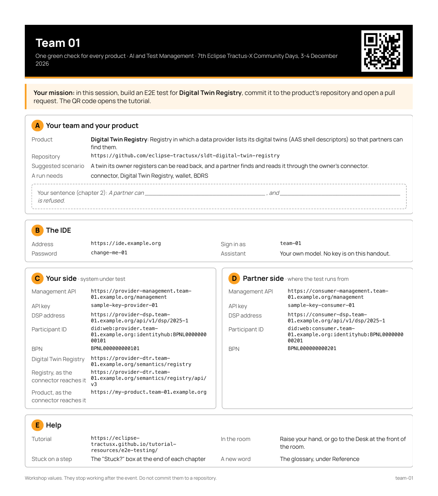

# Handouts

One printable page per team: team name, product and repository, their connectors, the IDE
address and where to get help.

[Home](../index.md) · [For administrators](index.md)



## What goes in

| Source | Gives the handout |
| --- | --- |
| [`catalog/products.json`](https://github.com/eclipse-tractusx/tutorial-resources/blob/main/e2e-testing/catalog/products.json) | Product, repository, scenario, what a run needs |
| [`catalog/assignments.json`](https://github.com/eclipse-tractusx/tutorial-resources/blob/main/e2e-testing/catalog/assignments.json) | Which team has which product |
| Your **connector inventory** | The IDE address, the account, both connectors of each team |

The inventory is a JSON file you write. Start from the sample:
[`admin/handouts/inventory.sample.json`](https://github.com/eclipse-tractusx/tutorial-resources/blob/main/e2e-testing/admin/handouts/inventory.sample.json).
Its fields are described in
[`inventory.schema.json`](https://github.com/eclipse-tractusx/tutorial-resources/blob/main/e2e-testing/admin/handouts/inventory.schema.json).

## Build them

From the folder `e2e-testing`:

```bash
pip install -r requirements.txt
cp admin/handouts/inventory.sample.json admin/handouts/inventory.json
```

Edit `admin/handouts/inventory.json`: one entry under `teams` for every team in
`assignments.json`. Then:

```bash
python admin/handouts/build_handouts.py --inventory admin/handouts/inventory.json
```

```text
team-01: team-01.html, team-01.pdf
team-02: team-02.html, team-02.pdf
```

The pages are written to `admin/handouts/out/`. The PDFs need a Chrome, Chromium or Edge
on the machine. If none is found, name one with `--browser <path>`, or open the HTML pages
and print them yourself.

## The five boxes

| Box | Holds | Used in |
| --- | --- | --- |
| **A** | Team, product, repository, scenario, and room for the team's sentence | Chapters 1 and 2 |
| **B** | IDE address and account | Chapter 3 |
| **C** | Your side: the provider connector, its registry and the product behind it | Chapter 5 |
| **D** | Partner side: the connector the test runs from | Chapter 5, for reference |
| **E** | Help | Always |

## Keep the keys out of Git

> [!CAUTION]
> The real inventory and the handouts hold addresses and keys.
>
> - `admin/handouts/.gitignore` ignores `inventory.json` and `out/`. Keep it that way.
> - The repository only ever holds `inventory.sample.json`, with invented hosts under
>   `example.org` and invented keys.
> - Use keys that exist only for the event, and revoke them afterwards.

## The sample

[`admin/handouts/sample/team-01.pdf`](https://github.com/eclipse-tractusx/tutorial-resources/blob/main/e2e-testing/admin/handouts/sample/team-01.pdf)
was built with the command above from the sample inventory.

## Change the layout

The page is [`admin/handouts/template.html`](https://github.com/eclipse-tractusx/tutorial-resources/blob/main/e2e-testing/admin/handouts/template.html):
plain HTML and CSS, one A4 page. Words that start with `$` are filled in by the generator.

---

[← Assign products](assign.md) · [Home](../index.md) · [Run of show →](run-of-show.md)

## NOTICE

This work is licensed under the [CC-BY-4.0](https://creativecommons.org/licenses/by/4.0/legalcode).

- SPDX-License-Identifier: CC-BY-4.0
- SPDX-FileCopyrightText: 2026 Contributors to the Eclipse Foundation
- SPDX-FileCopyrightText: 2026 Catena-X Automotive Network e.V.
- Source URL: <https://github.com/eclipse-tractusx/tutorial-resources>
