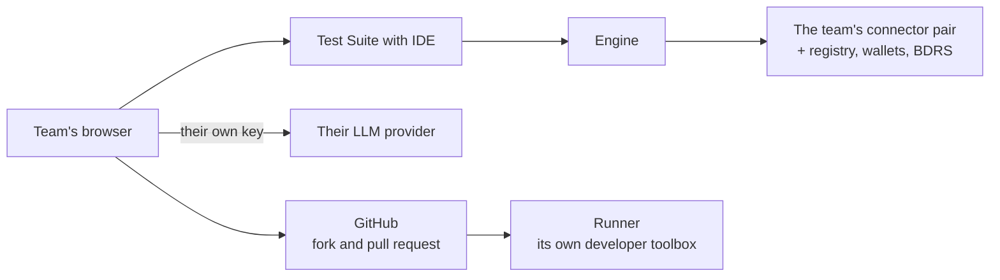

# For administrators

Everything the people running the session need: what to deploy, what to configure, who
gets which product, what to print, and the session itself.

[Home](../index.md)

## The kit

| Page | Use it to |
| --- | --- |
| [Deploy](deploy.md) | Bring up the Test Suite with its IDE and the connectors |
| [Configure](configure.md) | Create organizations, users and one connector pair per team |
| [Assign products](assign.md) | Decide which team works on which product |
| [Handouts](handouts.md) | Print one page per team from the catalog, the assignments and your connector list |
| [Run of show](run-of-show.md) | Run the session, minute by minute |
| [Presentation prompt](presentation-prompt.md) | Generate the ten-minute opening |

## What a team needs in the room

The model is the team's own. Nothing about it is deployed or paid for by the event.

## Pre-event checklist

### Two weeks before

- [ ] The tutorial pull request is **merged**, so that the reusable workflow exists at
  `eclipse-tractusx/tutorial-resources/.github/workflows/e2e-test.yml@main`. Until then the
  workflow call in chapter 6 has nothing to call.
- [ ] The team list is final. See [Assign products](assign.md).
- [ ] The committers of every assigned product know that a pull request is coming, and
  agree to approve workflow runs of first-time contributors on the day.
- [ ] The invitation tells participants to complete the [Prerequisites](../reference/prepare.md):
  ECA, Git, and a model of their own.

### One week before

- [ ] The Test Suite is deployed at its final address. See [Deploy](deploy.md).
- [ ] Organizations, users and connector pairs exist. See [Configure](configure.md).
- [ ] One person who did not build the setup does the whole tutorial from a handout, on a
  guest network, with a personal API key. Write down every place they stopped.
- [ ] The opening deck exists. See [Presentation prompt](presentation-prompt.md).

### Two days before

- [ ] Fix list from the dry run is done.
- [ ] Handouts are built from the real inventory and printed. See [Handouts](handouts.md).
- [ ] Screenshots in the tutorial still match the deployed IDE. Retake the ones that do not.
- [ ] The addresses on the handout are the final ones.

### On the day, 30 minutes before

From a laptop on the **venue's guest network**:

- [ ] The IDE opens and a workshop account can sign in.
- [ ] `api.openai.com` and `api.anthropic.com` are reachable from the browser.
- [ ] **Compile** on the template project is green.
- [ ] **Run** on the template project passes against one team's connector pair.
- [ ] `github.com` is reachable, and a `git push` works.
- [ ] The last run of the
  [worked example's workflow](https://github.com/eclipse-tractusx/tutorial-resources/actions/workflows/e2e-testing-example.yml)
  is green.

## Open decisions

| Decision | Default used in this kit |
| --- | --- |
| Address of the IDE at ARENA2036 | Placeholder `https://ide.example.org` |
| Team list | Five invented teams in `catalog/assignments.json` |
| One connector pair per team, or one shared pair | One pair per team |
| Whether participants get personal accounts | One account per team |

---

[Home](../index.md) · [Deploy →](deploy.md)

## NOTICE

This work is licensed under the [CC-BY-4.0](https://creativecommons.org/licenses/by/4.0/legalcode).

- SPDX-License-Identifier: CC-BY-4.0
- SPDX-FileCopyrightText: 2026 Contributors to the Eclipse Foundation
- SPDX-FileCopyrightText: 2026 Catena-X Automotive Network e.V.
- Source URL: <https://github.com/eclipse-tractusx/tutorial-resources>
