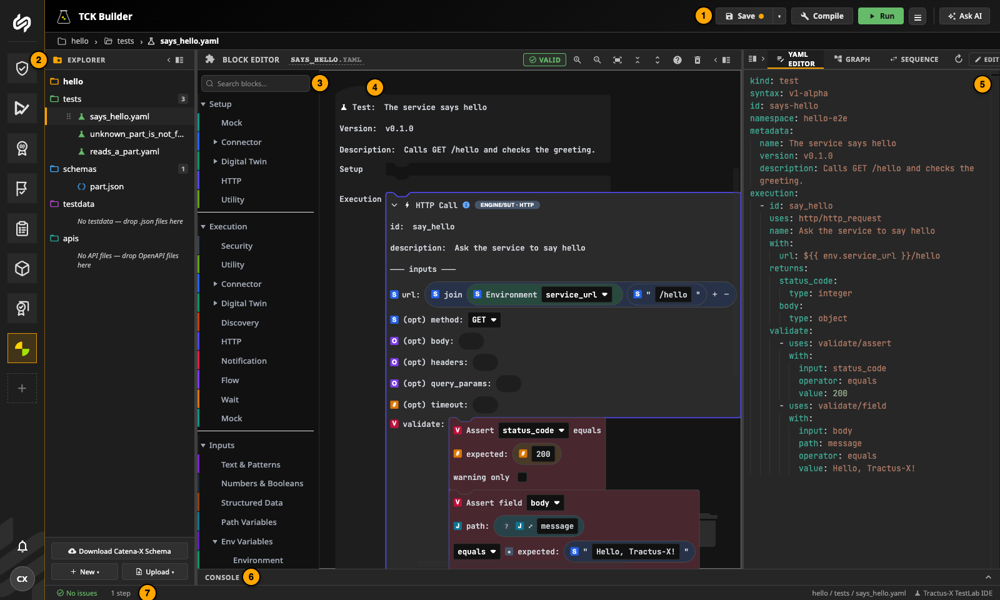
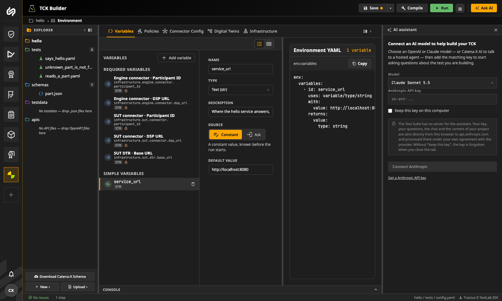

# The Test Suite IDE

The IDE builds a [TCK project](glossary.md#tck-project) in the browser. Each test shows as
**blocks** and as **YAML**: change one, the other follows. It also compiles and runs.

[Home](../index.md) · [3 · Hello, TestLab](../tutorial/03-hello-testlab.md) · [Syntax cheat sheet](syntax.md)

## The screen

Open the Test Suite (box **B** of your handout) and click the **Test Suite IDE** icon on the
left. **Open File** takes a project `.zip`, a `.yaml` or a `.tck`.

| | Area | Use it to |
| --- | --- | --- |
| 1 | **Top bar** | **Save**, **Compile**, **Run**, **☰** project settings, **Ask AI** |
| 2 | **Explorer** | Open files. **New ▾ → New Test** adds a test. |
| 3 | **Toolbox** | Find blocks. Type in **Search blocks…** |
| 4 | **Block editor** | Edit the test as blocks |
| 5 | **Side panel** | **YAML Editor**, **Graph**, **Sequence** (Ctrl+Alt+B / ⌘+⌥+B) |
| 6 | **Console** | Read the log of a compile or run |
| 7 | **Status bar** | See the number of issues |

To write YAML instead of blocks: **YAML Editor → Edit**, type, then **Save**.

## Variables

**☰ → Environment → Variables**. Click a variable to change its value.

## Run

1. Click **Run** and save the draft. Click **Run** again if it does not start.
2. Under **Infrastructure**, pick the app under test and the connectors the test needs.

    

3. Click **Next** to **Summary & Launch**, then **Run**.

The result shows in the top bar (**PASSED** or **FAILED**) and in the console.
[Chapter 6](../tutorial/06-run-it.md) runs against real connectors.

## Save and export

- **Save** keeps a version in your organization.
- **☰ → File → Export** downloads the project as a ZIP: your repository's `tck/e2e`
  ([chapter 7](../tutorial/07-add-to-repository.md)).

## The assistant

**Ask AI** opens the assistant. Your key goes from your browser straight to the provider.
[Chapter 4](../tutorial/04-choose-your-ai/index.md) connects it.

---

[← Syntax cheat sheet](syntax.md) · [Home](../index.md) · [The workflow →](workflow.md)

## NOTICE

This work is licensed under the [CC-BY-4.0](https://creativecommons.org/licenses/by/4.0/legalcode).

- SPDX-License-Identifier: CC-BY-4.0
- SPDX-FileCopyrightText: 2026 Contributors to the Eclipse Foundation
- SPDX-FileCopyrightText: 2026 Catena-X Automotive Network e.V.
- SPDX-FileCopyrightText: 2026 LKS Next
- Source URL: <https://github.com/eclipse-tractusx/tutorial-resources>
