# The Test Suite IDE

The **Test Suite IDE** builds a [TCK project](glossary.md#tck-project) in the browser. Every
test is shown twice: as **blocks** you can click together, and as the **YAML** that TestLab
compiles. Change one and the other follows. The IDE compiles and runs the project too, so you
see a test pass before it ever reaches your repository.

The screenshots show the finished project of
[chapter 3](../tutorial/03-hello-testlab.md), `examples/hello`.

[Home](../index.md) · [3 · Hello, TestLab](../tutorial/03-hello-testlab.md) · [Syntax cheat sheet](syntax.md)

## Open it

Open the Test Suite (box **B** of your handout) and click the **Test Suite IDE** icon in the
bar on the left. The page is titled **TCK Builder** and starts on the welcome screen.

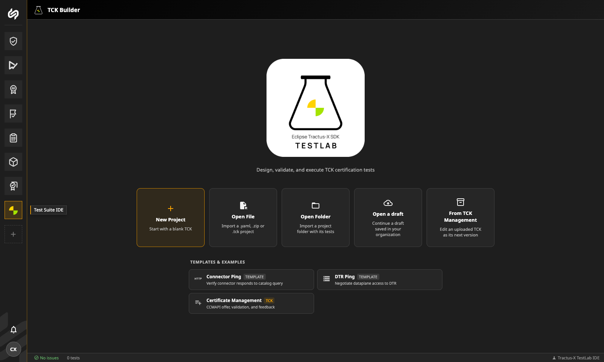

| Card | Opens |
| --- | --- |
| **New Project** | An empty project |
| **Open File** | A `.zip` of a project (like `hello-start.zip`), a single `.yaml` or a compiled `.tck` |
| **Open Folder** | A project folder on your laptop, for example `tck/e2e` of your repository |
| **Open a draft** | A draft saved earlier in your organization |
| **From TCK Management** | A TCK already uploaded, to edit as its next version |

Once a project is open, the same choices are under **☰ → File**.

## The screen

| | Area | What it is for |
| --- | --- | --- |
| 1 | **Top bar** | **Save** keeps a version of the project in your organization. **Compile** checks it the way TestLab does. **Run** runs it. **☰** holds the project settings. **Ask AI** opens the assistant. |
| 2 | **Explorer** | The project's files: `tests`, `schemas`, `testdata` and `apis`. Click the project name for its overview, a file to open it. **New ▾** adds a file, **Upload ▾** brings one in. |
| 3 | **Toolbox** | Every block, sorted by phase: **Setup**, **Execution**, **Teardown**, then **Inputs** and **Validation**. Type in **Search blocks…** to find one. |
| 4 | **Block editor** | The test as blocks. **VALID** at the top means the test is complete. |
| 5 | **Side panel** | **YAML Editor** shows the same test as text, **Graph** as a flow, **Sequence** as the calls between the parties. Open and close it at the right edge, or with Ctrl+Alt+B (⌘+⌥+B on a Mac). |
| 6 | **Console** | The log of a compile or a run, with **Problems**, **Network** and **Performance** tabs once something has run. Click it to open it. |
| 7 | **Status bar** | The number of issues and of tests. Click the issues to see them. |

## The project overview

Click the project name at the top of the Explorer. You see what the manifest says (name,
version, author, description) and the **stages**: the tests in the order they run.

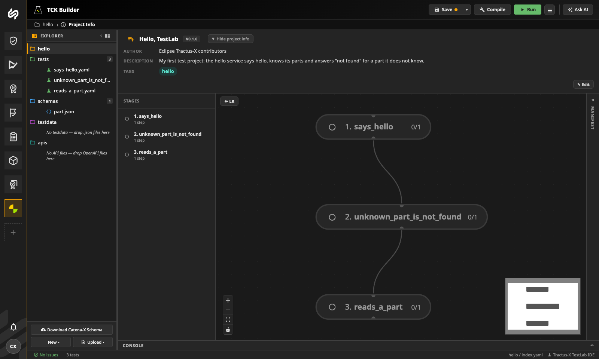

After a run, each stage shows whether it passed. Click a stage to decide whether a run may
leave the test out, and what happens when it fails.

## Add a test

**New ▾ → New Test** adds `tests/new-test.yaml` and registers it in the manifest for you.

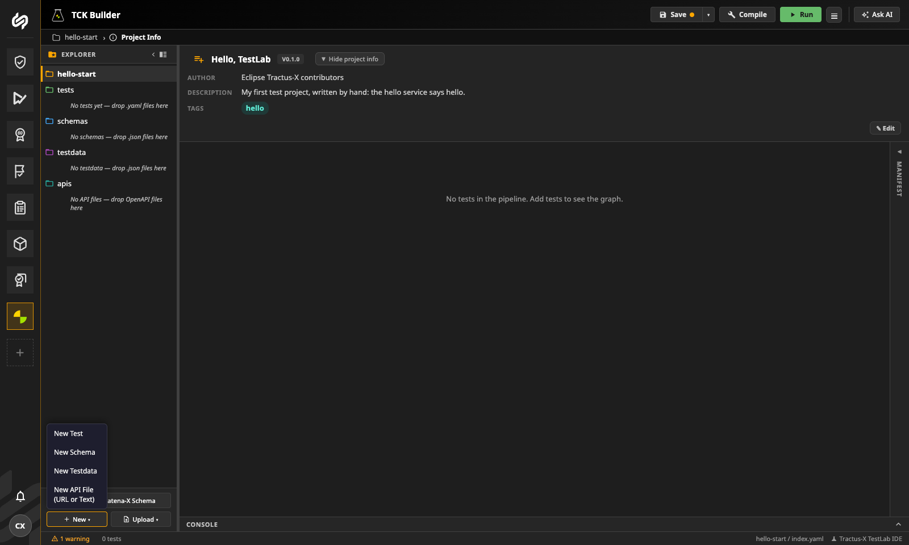

Then build it in either of two ways:

- **With blocks.** Drag a block from the toolbox onto **Setup**, **Execution** or
  **Teardown**, or click it to add it. Fill in its fields. A field that takes a value from
  somewhere else (a variable, the output of an earlier step) takes a block from **Inputs**.
- **As text.** Open the **YAML Editor**, click **Edit**, write or paste, and click **Save**
  in the editor. The blocks are redrawn from the text. Until you save, the blocks show the
  old version.

Searching the toolbox shows each matching block with its inputs and the outputs it
publishes:

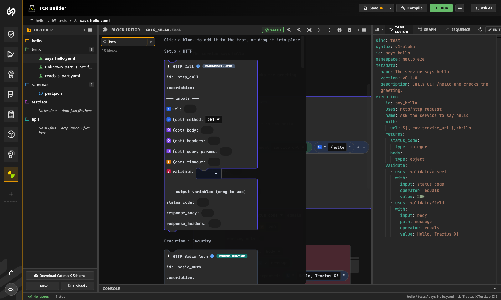

## Read a test

The **Graph** tab draws the test as a flow, from **START** through each phase to the automatic
clean-up. Use it to check the order of the steps in a long test.

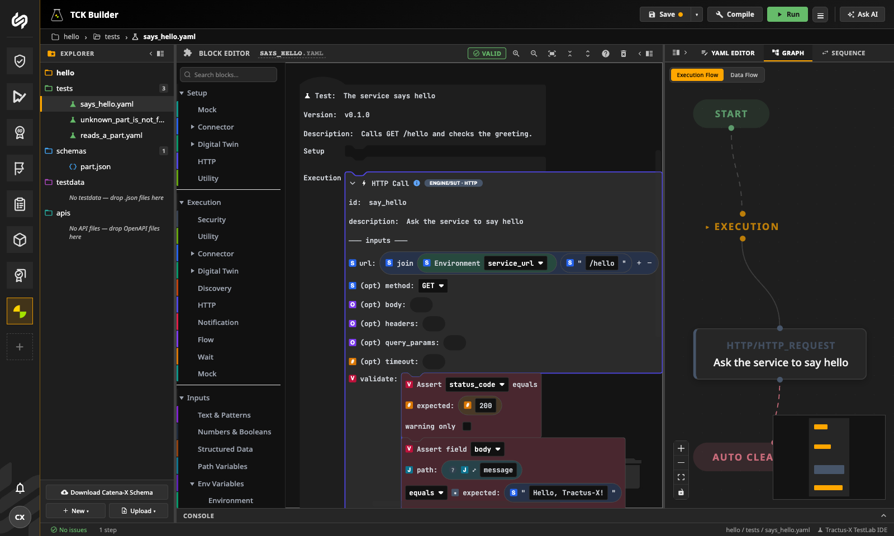

## Variables and the rest of the project

**☰** in the top bar holds what belongs to the whole project rather than to one test:

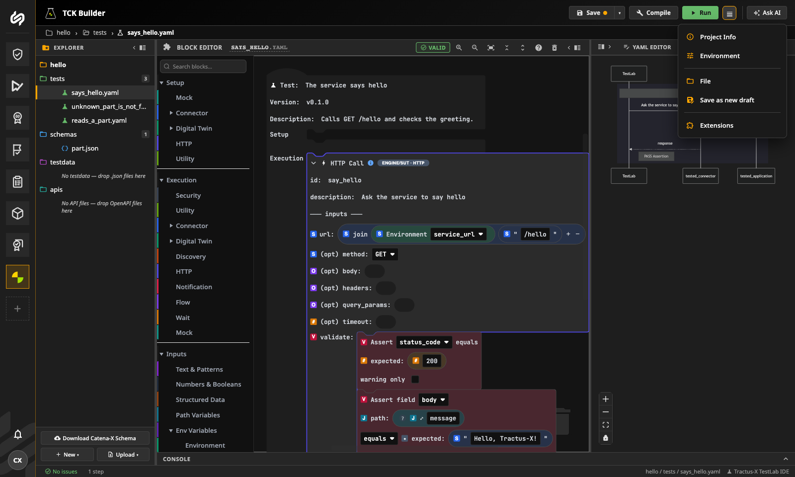

| Entry | Holds |
| --- | --- |
| **Project Info** | The manifest's name, version, description, authors and tags |
| **Environment** | Variables, policies, connector configuration, digital twins and the infrastructure the project needs |
| **File** | Open another project, import an OpenAPI file, start from an example, **Export** the project as a ZIP |
| **Save as new draft** | A copy of the project under another name |
| **Extensions** | Opt-in step families, such as the experimental `labs` steps |

Under **Environment → Variables**, click a variable to change it. **Constant** is a value
known before the run, written in the manifest. **Ask** makes the run ask for it. The
**Required variables** at the top are the values every run gets from the infrastructure you
choose when you run, such as the connector's DSP URL.

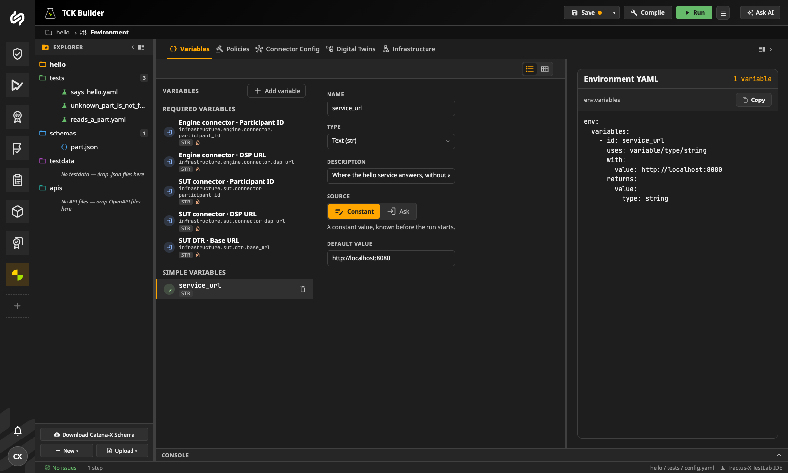

## Compile

**Compile** checks the project the way TestLab's compiler does: the syntax, every reference,
every step's inputs and outputs. A green **Compilation passed** means the project would
compile on the command line, and in the [workflow](workflow.md), too.

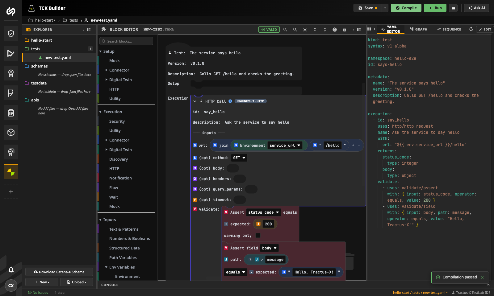

When something is wrong, the status bar counts the issues. Click it, or open the console's
**Problems** tab: each issue names the file and the field.

## Run

1. Click **Run**. A run needs a saved draft: the first time, name it and click
   **Save draft**. If the run does not start by itself, click **Run** again.

    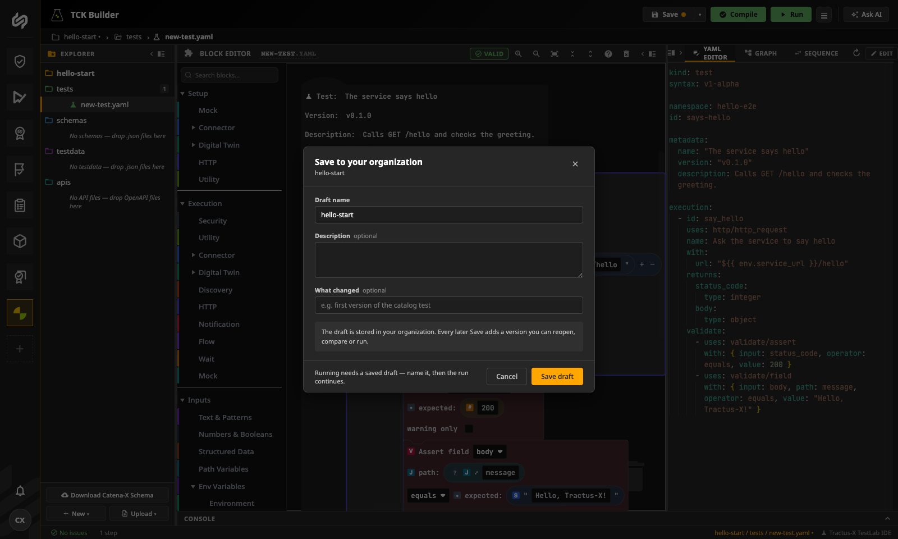

2. The dialog **Run to debug** opens with five steps. **Build** is done for you. Under
   **Infrastructure**, choose the app the run is for, and the connectors and registry the
   test needs. **Register an app** adds one that is missing.

    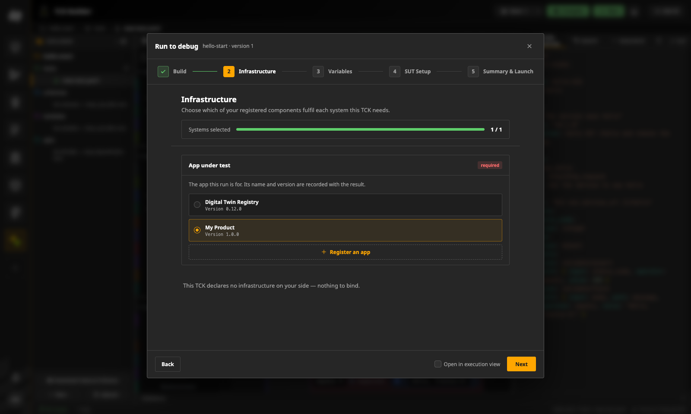

3. **Variables** asks for every variable with the source **Ask**. **SUT Setup** lists what
   must be prepared on your side. Click **Next** through both.
4. **Summary & Launch** lists the tests that will run. Click **Run**.

    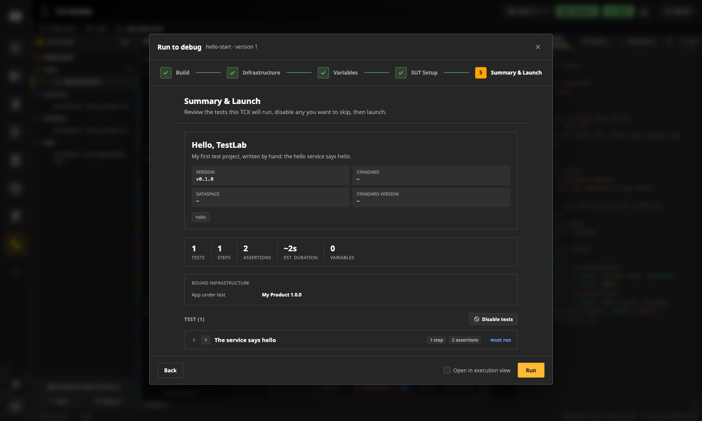

The result appears where you are: **PASSED** or **FAILED** in the top bar, a mark on each
stage, and the log in the console. **Open in execution view** shows the whole run, with every
request and answer under **Network**.

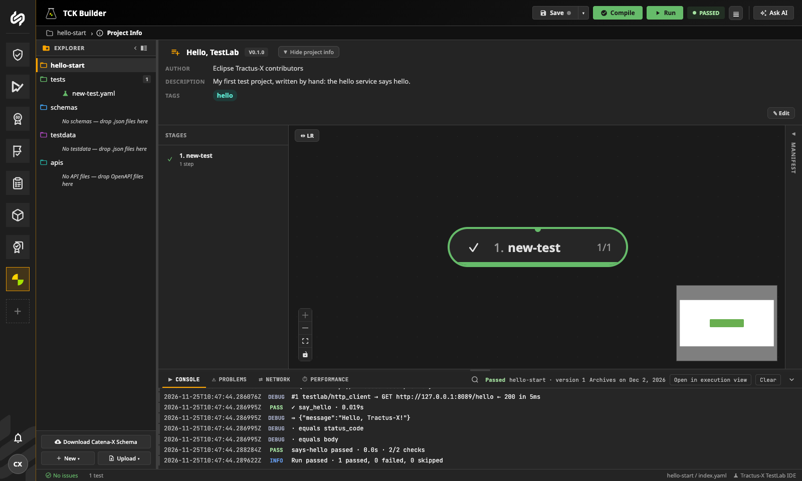

[Chapter 6](../tutorial/06-run-it.md) runs a test against real connectors, and explains what
to choose under **Infrastructure**.

## Save, export, take it home

- **Save** keeps a new version of the draft in your organization. **Open a draft** brings it
  back, on any computer.
- **☰ → File → Export** downloads the project as a ZIP. Unpacked, it is the folder `tck/e2e`
  of your repository ([chapter 7](../tutorial/07-add-to-repository.md)).

## The assistant

**Ask AI** opens the assistant on the right. Connect a model first; your key goes from your
browser straight to the provider, never through the Test Suite. The assistant reads the files
of the project and edits them while you watch. [Chapter 4](../tutorial/04-choose-your-ai.md)
connects it.

---

[← Syntax cheat sheet](syntax.md) · [Home](../index.md) · [The workflow →](workflow.md)

## NOTICE

This work is licensed under the [CC-BY-4.0](https://creativecommons.org/licenses/by/4.0/legalcode).

- SPDX-License-Identifier: CC-BY-4.0
- SPDX-FileCopyrightText: 2026 Contributors to the Eclipse Foundation
- SPDX-FileCopyrightText: 2026 Catena-X Automotive Network e.V.
- Source URL: <https://github.com/eclipse-tractusx/tutorial-resources>
