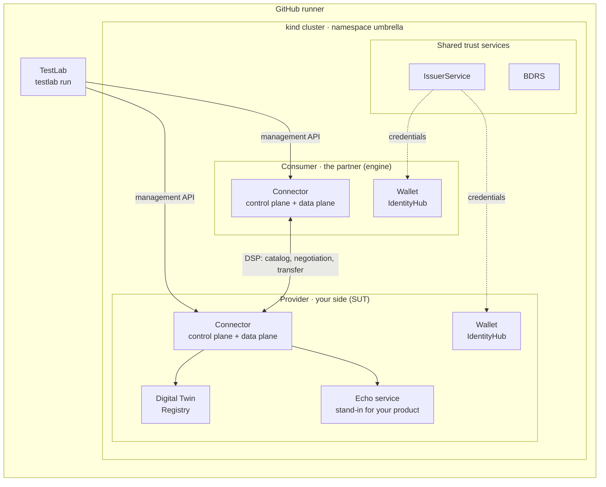
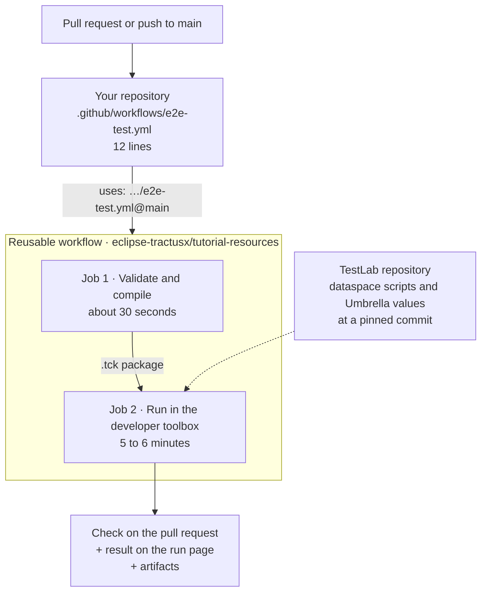

# The developer toolbox

An E2E test needs a dataspace to run in: two companies, each with a connector and a wallet,
and the services that let them trust each other. The **Eclipse Tractus-X developer
toolbox** is that dataspace. The [workflow](workflow.md) builds it from nothing inside the
GitHub runner for every run, and throws it away afterwards. No external cluster, no secrets,
no shared state between runs.

[Home](../index.md) · [The workflow](workflow.md)

## What is in it

| Part | What it does in a run | Host name in the cluster |
| --- | --- | --- |
| Provider connector | Offers your product. The [SUT](glossary.md#sut) side of the test. | `provider-dsp.local` (DSP), `provider-management.local`, `provider.local` (data) |
| Consumer connector | Finds, negotiates and fetches, as a partner would. The [engine](glossary.md#engine) side. | `consumer-dsp.local` (DSP), `consumer-management.local`, `consumer.local` (data) |
| Two wallets (IdentityHub) | Hold each company's credentials and present them in a negotiation. | in-cluster only |
| IssuerService | Issues the Catena-X credentials both companies need. | `issuerservice.local` |
| BDRS | Translates a [BPN](glossary.md#bpn) into a [DID](glossary.md#did). | `bdrs-server.tx.test` |
| Digital Twin Registry | The provider's registry, for tests that work with twins. | `provider-dtr.local` |
| Echo service | Answers every request with what it received: a product to offer before you have your own. | in-cluster only |
| Stub caller and submodel server | Helpers for tests that need someone to call them, or data behind a twin. | `tck-stub.local`, `tck-submodel.local` |

It is built from the [Tractus-X Umbrella](glossary.md#umbrella) Helm chart, version
`26.03.00`, in its decentralized IdentityHub profile, on a [kind](https://kind.sigs.k8s.io/)
cluster (Kubernetes 1.31) with ingress-nginx. Every version is pinned in the workflow, so
a run today and a run next month see the same dataspace.

## How it comes up

The second job of the workflow, **Run in Eclipse Tractus-X developer toolbox**, goes
through six stages. The whole job takes five to six minutes on a standard runner.

| Stage | What happens | Why |
| --- | --- | --- |
| **1 · Prepare** | Checks out your project and TestLab's dataspace scripts, installs TestLab and downloads the `.tck` package the first job compiled. | The run uses exactly the package that was validated. |
| **2 · Cluster** | Frees disk space, creates the kind cluster, installs ingress-nginx, and points every host name above at the cluster: in the runner's `/etc/hosts` and in the cluster's own DNS. | The same address works from TestLab on the runner and from one pod to the next. |
| **3 · Deploy** | Generates the connectors' vault secrets, prepares the pinned Umbrella values, pre-loads the images and installs the chart, waiting until every pod is ready. Then deploys the echo service, the stub caller and the submodel server. | Readiness before the chart's setup hooks: they seed the vaults and the issuer's records. |
| **4 · Credentials** | Asks the IssuerService to issue the Catena-X credentials to both companies: membership, BPN, data exchange governance (the framework agreement) and usage purpose. | Without them every contract negotiation is refused. |
| **5 · Preflight** | Finds the addresses the chart did not fix, then checks that pods reach the runner, the helpers and each other, and that the connectors and the registry answer. | A broken environment fails here, clearly, before a test could fail for the wrong reason. |
| **6 · Run** | Writes the run configuration, runs `testlab run` on the package and puts the result on the run page. | Your test against a live dataspace. |

Afterwards, pass or fail, the job collects the state and logs of every pod, uploads the
results and deletes the cluster.

## How the workflow is structured

Three places, each with one job:

| Where | What lives there | Who changes it |
| --- | --- | --- |
| Your repository | The [test project](glossary.md#tck-project) in `tck/e2e` and the 12-line calling workflow | The product's team |
| `tutorial-resources` | The [reusable workflow](glossary.md#reusable-workflow): both jobs, the developer toolbox's versions | Once, for every product |
| `tractusx-testlab` | The scripts that issue credentials and check the dataspace, and the Umbrella values | TestLab, pinned by commit |

So a product team keeps 12 lines of workflow and its own test. When the dataspace or
TestLab moves on, one change in the reusable workflow moves every product along.

Every run leaves three artifacts, kept for 14 days:

| Artifact | Holds | Open it when |
| --- | --- | --- |
| `e2e-test-package-…` | The compiled `.tck` package | You want to run the same package elsewhere |
| `e2e-test-run-…` | The run's console log and its execution trace: every request, answer and check | A test failed and you want to see why |
| `toolbox-diagnostics-…` | The state and logs of every pod in the cluster | A deploy or preflight step failed |

## How your test meets the toolbox

Your test never names a host. It names the side and the capability it needs, for example
`${{ infrastructure.sut.connector.dsp_url }}`, and the workflow fills in the toolbox's
addresses when it writes the run configuration. The [workflow](workflow.md#values-your-test-gets-for-free)
page lists every value. Anything else your project needs, you add with the `config` input.

The same test therefore runs unchanged in the toolbox, in the workshop's connectors and in
anybody's own environment.

## What it cannot do yet

- **It runs released images.** To test the code of your pull request, build your image and
  pass it with the `toolbox-values` input (see [the workflow](workflow.md#test-the-image-from-your-pull-request)).
- **It holds the products of the Umbrella chart.** A product that is not in the chart cannot
  run there yet. Set `run-in-toolbox: false`: the workflow then only validates and compiles.
- **It is one dataspace of two companies.** Tests that need a third participant need more.

---

[← The workflow](workflow.md) · [Home](../index.md) · [The .tractusx link →](metafile.md)

## NOTICE

This work is licensed under the [CC-BY-4.0](https://creativecommons.org/licenses/by/4.0/legalcode).

- SPDX-License-Identifier: CC-BY-4.0
- SPDX-FileCopyrightText: 2026 Contributors to the Eclipse Foundation
- SPDX-FileCopyrightText: 2026 Catena-X Automotive Network e.V.
- Source URL: <https://github.com/eclipse-tractusx/tutorial-resources>
