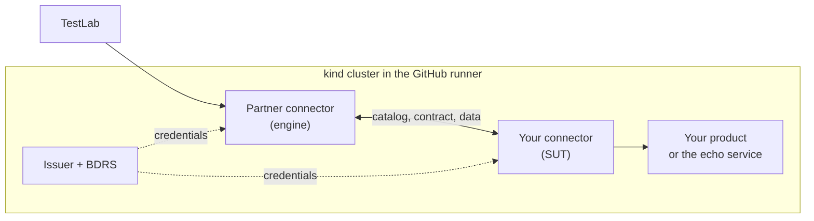
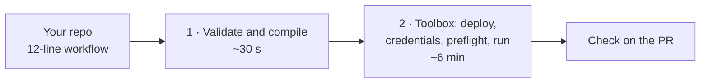

# The developer toolbox

An E2E test needs a small dataspace: two companies, each with a connector and a wallet. The
**Eclipse Tractus-X developer toolbox** is that dataspace. The [workflow](workflow.md)
builds it inside the GitHub runner for every run and deletes it afterwards.

[Home](../index.md) · [The workflow](workflow.md)

## What is in it

- **Two connectors with wallets**: yours (the [SUT](glossary.md#sut)) and a partner's (the
  [engine](glossary.md#engine)).
- **Trust services**: the IssuerService hands out the Catena-X credentials; BDRS maps a BPN
  to a DID.
- **Digital Twin Registry** and an **echo service** that stands in for your product.

It is the [Tractus-X Umbrella](glossary.md#umbrella) chart `26.03.00` on a kind cluster.
Every version is pinned.

## How a run works

1. **Validate and compile** your project into a `.tck` package.
2. **Build the toolbox**, issue credentials, check every service answers.
3. **Run** the package and report the result on the pull request.

Your repository holds only the test and 12 lines of workflow. The rest lives in this
repository, so one change here updates every product.

If a run fails, download the artifacts: `e2e-test-run-…` has every request and answer,
`toolbox-diagnostics-…` the logs of every pod.

## Your test never names a host

It asks for a side and a capability, for example `${{ infrastructure.sut.connector.dsp_url }}`.
The workflow fills in the addresses ([list](workflow.md#values-your-test-gets-for-free)). So
the same test runs in the toolbox, at the workshop and in your own environment.

## Limits

- It runs released images. To test your pull request's code, see
  [the workflow](workflow.md#test-the-image-from-your-pull-request).
- Only products in the Umbrella chart run there. Others set `run-in-toolbox: false`.

---

[← The workflow](workflow.md) · [Home](../index.md) · [The .tractusx link →](metafile.md)

## NOTICE

This work is licensed under the [CC-BY-4.0](https://creativecommons.org/licenses/by/4.0/legalcode).

- SPDX-License-Identifier: CC-BY-4.0
- SPDX-FileCopyrightText: 2026 Contributors to the Eclipse Foundation
- SPDX-FileCopyrightText: 2026 Catena-X Automotive Network e.V.
- Source URL: <https://github.com/eclipse-tractusx/tutorial-resources>
