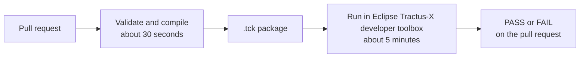

# The workflow

A test that somebody has to remember to run will not be run. This workflow runs it on
every pull request.

[Home](../index.md)

## Copy these lines

Save as `.github/workflows/e2e-test.yml` in your repository.
The full file with its licence header is in the
[worked example](https://github.com/eclipse-tractusx/tutorial-resources/blob/main/e2e-testing/examples/digital-twin-registry/.github/workflows/e2e-test.yml).

```yaml
name: E2E test

on:
  pull_request:
  push:
    branches: [main]
  workflow_dispatch:

permissions:
  contents: read

concurrency:
  group: e2e-test-${{ github.event.pull_request.number || github.ref }}
  cancel-in-progress: true

jobs:
  e2e:
    name: E2E test
    uses: eclipse-tractusx/tutorial-resources/.github/workflows/e2e-test.yml@main
    with:
      tck-directory: tck/e2e
```

That is all a product repository needs. The work happens in the
[reusable workflow](glossary.md#reusable-workflow) it calls.

## What it does



| Job | Needs | Tells the maintainers |
| --- | --- | --- |
| **Validate and compile** | Nothing but Python | The test project is well-formed and still compiles. |
| **Run in Eclipse Tractus-X developer toolbox** | A dataspace, which the job creates itself | The product still keeps its promise. |

On the fork where it was proven, the first job took 23 seconds and the second 4 minutes
57 seconds.

The second job starts the [Eclipse Tractus-X developer toolbox](glossary.md#eclipse-tractus-x-developer-toolbox): a Kubernetes
cluster inside the runner with two connectors, two wallets, a Digital Twin Registry, a BDRS
and an IssuerService, deployed from the Tractus-X Umbrella chart. It issues the
participants' credentials, runs the package and throws everything away. No secrets, no
external cluster.

It does the same job as TestLab's own
[E2E workflow](https://github.com/eclipse-tractusx/tractusx-testlab/blob/main/.github/workflows/e2e-umbrella.yml):
its dataspace steps are taken from there.

## Inputs

| Input | Default | Use it to |
| --- | --- | --- |
| `tck-directory` | `tck/e2e` | Point at the folder that holds `index.yaml`. |
| `testlab-version` | `1.0.0a24` | Pin the TestLab version that validates, compiles and runs. |
| `run-in-toolbox` | `true` | Set to `false` to only validate and compile, for a product the developer toolbox cannot run yet. |
| `config` | none | Add run values of your own: a YAML file with `variables:`. |
| `toolbox-values` | none | Add Helm values to the developer toolbox, for example the image built from this pull request. |

## Values your test gets for free

The workflow fills in everything about the dataspace it created:

| Value | What it is |
| --- | --- |
| `infrastructure.sut.connector.*` | The provider's connector: your side |
| `infrastructure.engine.connector.*` | The consumer's connector: the partner side |
| `infrastructure.sut.dtr.base_url` | The provider's Digital Twin Registry |
| `sut_bpnl`, `engine_bpnl` | The two [BPNs](glossary.md#bpn) |
| `dtr_internal_url` | The registry as the provider's connector reaches it |
| `product_internal_url` | A small echo service behind the provider's connector: a stand-in for a product |

Anything else your project declares as an input goes into a file of your own, named with
the `config` input:

```yaml
variables:
  my_own_value: "something"
```

## Test the image from your pull request

Out of the box the developer toolbox deploys **released** images. To test the code of the pull
request, build your image in a job of your own and pass its tag as Helm values:

```yaml
    with:
      tck-directory: tck/e2e
      toolbox-values: tck/e2e/ci/values.yaml
```

> [!NOTE]
> The `toolbox-values` input is applied by the workflow, but this page's example of
> building and loading an image was **not run**. Loading a locally built image into the
> cluster needs one more step in your own workflow.

## How it was checked

| Check | Result |
| --- | --- |
| `actionlint` | Passes. Four style notes come from the steps taken over from TestLab. |
| Real run on a fork of this repository, worked example | 3 tests passed |
| Real run on a fork of this repository, template | 2 tests passed |
| Real run in a fork of `sldt-digital-twin-registry`, called across repositories, with the project exported from the IDE | 3 tests passed, 5 minutes 25 seconds in total |
| `config` and `toolbox-values` inputs | **Not run** with a file of a calling repository |

## When it is red

1. Open the failed job and read **E2E test result** on the run page.
2. A failed **check** is a finding: the product answered, and not as promised.
3. A failed **deploy** step is the environment. Download the `toolbox-diagnostics`
   artifact: it holds the state and the logs of every pod.

---

[← The worked example](worked-example.md) · [Home](../index.md) · [The .tractusx link →](metafile.md)

## NOTICE

This work is licensed under the [CC-BY-4.0](https://creativecommons.org/licenses/by/4.0/legalcode).

- SPDX-License-Identifier: CC-BY-4.0
- SPDX-FileCopyrightText: 2026 Contributors to the Eclipse Foundation
- SPDX-FileCopyrightText: 2026 Catena-X Automotive Network e.V.
- Source URL: <https://github.com/eclipse-tractusx/tutorial-resources>
