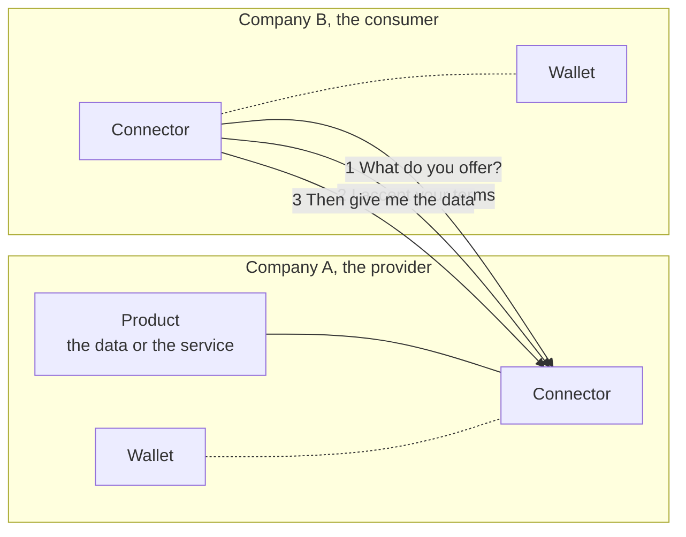

# A dataspace in five minutes

The story · 2 of 4 · optional reading, 5 minutes

You can follow the tutorial without this page. Read it if words like *connector* or
*BPN* are new, or if you want to know what your test is actually doing.

## Two companies, no middleman

A dataspace lets companies exchange data **directly**, each keeping control of its own.
There is no central database. There are rules everyone follows, and a small set of
building blocks every participant runs.

Picture two companies. One has data, the other wants it.

## The four building blocks you will meet

| Block | In one line | Real-world picture |
| --- | --- | --- |
| [Connector](../reference/glossary.md#connector) | The door of a company to the dataspace. Every exchange goes through it. | The goods-in gate with a guard |
| [Wallet](../reference/glossary.md#wallet) | Holds the company's proofs, for example "I am a member of this dataspace". | A folder of stamped certificates |
| [Digital Twin Registry](../reference/glossary.md#digital-twin-registry) | A list of the things a company has data about, and where that data is. | The index cards of a library |
| [BDRS](../reference/glossary.md#bdrs) | Translates a company number into the company's digital identity. | A phone book |

Every company has a [BPN](../reference/glossary.md#bpn), a Business Partner Number such as
`BPNL000000000001`. It is how participants name each other.

## One exchange, three steps

Every data exchange in the dataspace has the same three steps. Your test will walk
through them, because your product is reached the same way.

1. **Catalog.** The consumer's connector asks the provider's connector: *what do you
   offer me?* The answer is a list of [offers](../reference/glossary.md#asset-and-offer),
   each with a [policy](../reference/glossary.md#policy): the terms of use.
2. **Negotiation.** The consumer accepts an offer. Both connectors check each other's
   proofs from the wallets. If the terms are met, they sign a
   [contract agreement](../reference/glossary.md#contract-agreement).
3. **Transfer.** The consumer receives a short-lived token, the
   [EDR](../reference/glossary.md#edr), and uses it to fetch the data through the
   provider's [data plane](../reference/glossary.md#control-plane-and-data-plane).

If any proof is missing or the terms are not met, step 2 ends with a refusal.
A good test checks the refusal too.

## Where your product sits

Most Tractus-X products are one of two things:

- **A building block itself**, such as the connector, the wallet or the registry.
- **A service behind the connector**, such as a traceability application whose API a
  partner calls through the three steps above.

Either way, the E2E question is the same: *can a partner get what your product promises?*

## What the workshop gives you

Every team gets its own small dataspace: two connectors with their wallets, a Digital Twin
Registry and a BDRS. One side plays **your company with your product**. The other side is
**the partner**, and that is where your test runs from.

The same small dataspace is created inside GitHub Actions when your test runs in CI.
It is the [Eclipse Tractus-X developer toolbox](../reference/glossary.md#eclipse-tractus-x-developer-toolbox): the
Tractus-X Umbrella Helm chart with a small dataspace configuration, in memory in the runner.

---

[← Why we are here](why.md) · [Home](../index.md) · [Next: What a test is made of →](test-anatomy.md)

## NOTICE

This work is licensed under the [CC-BY-4.0](https://creativecommons.org/licenses/by/4.0/legalcode).

- SPDX-License-Identifier: CC-BY-4.0
- SPDX-FileCopyrightText: 2026 Contributors to the Eclipse Foundation
- SPDX-FileCopyrightText: 2026 Catena-X Automotive Network e.V.
- Source URL: <https://github.com/eclipse-tractusx/tutorial-resources>
