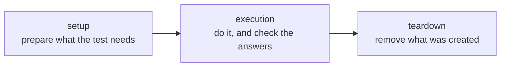
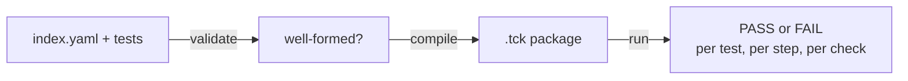

# What a test is made of

<span class="route">The story · 3 of 4 · optional reading, 5 minutes</span>

## A TCK is a folder of YAML

[TCK](../reference/glossary.md#tck) stands for Technology Compatibility Kit: a package of
tests that proves a system does what it promises. A **TCK project** is the editable form,
a folder you commit:

```text
tck/e2e/
├── index.yaml      the manifest: what is tested, what a run needs, which tests belong to it
├── tests/          one file per test
└── schemas/        JSON schemas an answer is checked against (optional)
```

## Two sides: the system under test, and the engine

A test always has two parties.

| Side | Called | Who it is today |
| --- | --- | --- |
| The one being tested | [SUT](../reference/glossary.md#sut), system under test | Your product and the connector in front of it |
| The one testing | [Engine](../reference/glossary.md#engine) | TestLab, acting as the partner through the second connector |

The manifest says what each side must bring:

```yaml
infrastructure:
  engine:
    connector:
      required: true
  sut:
    connector:
      required: true
    dtr:
      required: true
```

Addresses and keys are **not** in the project. They are given when the test runs, so the
same test runs in the workshop, in CI and in anybody's own environment.

## A test has three phases



Each phase is a list of [steps](../reference/glossary.md#step). A step uses one ready-made
action, passes values in, gets values back, and checks them:

```yaml
- id: read_twin
  uses: digital-twin-registry/consumer/dataplane/get_shell_descriptor   # the action
  name: Read the twin as the partner                                     # what a human reads
  with:                                                                  # values in
    aas_identifier: "${{ setup.create_shell.id }}"
  validate:                                                              # checks
    - uses: validate/assert
      with: { input: id, operator: equals, value: "${{ setup.create_shell.id }}" }
```

`${{ ... }}` refers to a value from somewhere else: an earlier step, a variable, or the
infrastructure of the run.

## Three kinds of check

| Kind | Question it answers | Example |
| --- | --- | --- |
| **Positive** | Does the promise hold? | A partner can read the twin. |
| **Negative** | Is the wrong thing refused? | A twin that does not exist is answered with 404. |
| **Contract** | Does the answer have the agreed shape? | The twin matches the JSON schema of the standard. |

A test that only ever checks "it answered with 200" proves that the system is switched on.
An E2E test proves that it keeps a promise.

## From YAML to a result



- **Validate** checks the files: known steps, known fields, values wired correctly.
- **Compile** turns the project into one package, the form that is run and shared.
- **Run** executes it against real systems and records every request and answer.

The IDE does all three with buttons. The workflow does all three with the
[TestLab](../reference/glossary.md#testlab) command line. Same engine, same result.

## A real one

The [worked example](../reference/worked-example.md) is a complete project for the Digital
Twin Registry: three tests, 19 steps, running green in GitHub Actions.

---

[← A dataspace in five minutes](dataspace.md) · [Home](../index.md) · [Next: Where the AI helps →](ai.md)

## NOTICE

This work is licensed under the [CC-BY-4.0](https://creativecommons.org/licenses/by/4.0/legalcode).

- SPDX-License-Identifier: CC-BY-4.0
- SPDX-FileCopyrightText: 2026 Contributors to the Eclipse Foundation
- SPDX-FileCopyrightText: 2026 Catena-X Automotive Network e.V.
- Source URL: <https://github.com/eclipse-tractusx/tutorial-resources>
