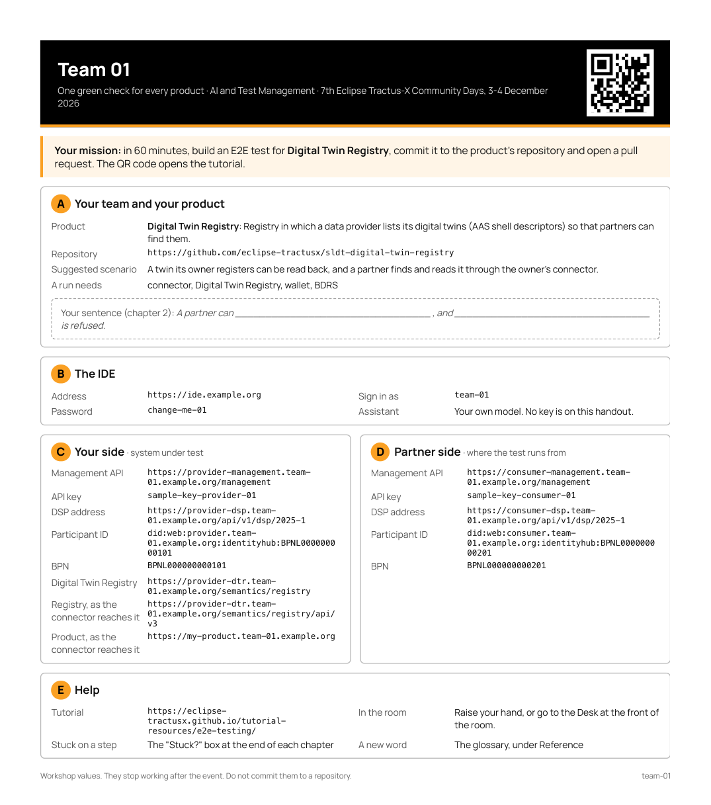

Getting Started · chapter 1 of 8 · ● ○ ○ ○ ○ ○ ○ ○

# 1 · Start here

> **Goal:** you know the mission, and your team has everything it needs.
> **Time:** 5 minutes

## The mission

Your team has been given one Eclipse Tractus-X product. In the next hour you prove one
thing that product promises, with an [E2E test](../reference/glossary.md#e2e-test) that
runs in the product's own repository.

You win when your pull request shows a green check.

## Steps

1. Take your team's **handout**. It has five boxes, **A** to **E**.
2. Read box **A**: your product, its repository and a suggested scenario.
3. Open this tutorial on the laptop you will work on. The QR code on the handout leads here.
4. In the same browser, sign in to **GitHub**.
5. Give out three roles. Swap them whenever you like.

    | Role | Does |
    | --- | --- |
    | **Driver** | Has the keyboard |
    | **Navigator** | Reads the steps aloud, keeps an eye on the clock |
    | **Skeptic** | Reads what the assistant writes and asks "can this check ever fail?" |

6. Raise your hand if a box on the handout is empty. Do not start without it.

## You should now see

A handout like this one, with your team's values in every box.

> [!TIP]
> **Stuck?**
>
> - **No GitHub account, or no signed ECA:** let a teammate who has both be the Driver.
>   What the [ECA](../reference/glossary.md#eca) is and how to sign it is in
>   [Prerequisites](../reference/prepare.md).
> - **Words on the handout mean nothing to you:** that is fine. The
>   [glossary](../reference/glossary.md) explains each one in a line, and
>   [A dataspace in five minutes](../story/dataspace.md) draws the picture.

---

[Home](../index.md) · [Next: 2 · Your product and your connectors →](02-your-product.md)

## NOTICE

This work is licensed under the [CC-BY-4.0](https://creativecommons.org/licenses/by/4.0/legalcode).

- SPDX-License-Identifier: CC-BY-4.0
- SPDX-FileCopyrightText: 2026 Contributors to the Eclipse Foundation
- SPDX-FileCopyrightText: 2026 Catena-X Automotive Network e.V.
- Source URL: <https://github.com/eclipse-tractusx/tutorial-resources>
