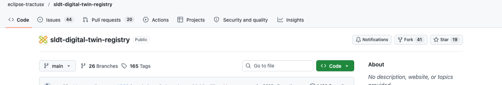

The tutorial · chapter 2 of 8 · ● ● ○ ○ ○ ○ ○ ○

# 2 · Your product and your connectors

> **Goal:** you can say in one sentence what your test will prove.
> **Time:** 5 minutes

## Steps

1. Open your product's repository (handout, box **A**) and read in its README
   what the product does.
2. Press **Fork** at the top right of the repository page, then **Create fork**.
   Leave the tab open; you need the [fork](../reference/glossary.md#fork-and-pull-request)
   in chapter 6.
3. Find your product in the [product catalog](../reference/catalog.md) and read its
   suggested scenario.
4. Look at boxes **C** and **D** of the handout. They are your two
   [connectors](../reference/glossary.md#connector):

    | Box | Plays | In the test it is called |
    | --- | --- | --- |
    | **C · Your side** | Your company, with your product | [SUT](../reference/glossary.md#sut), the system under test |
    | **D · Partner side** | Another company that uses your product | [Engine](../reference/glossary.md#engine), where the test runs from |

5. Complete this sentence together and write it on the handout:

    > *A partner can ________, and ________ is refused.*

    The first blank is your positive test, the second your negative test.

## You should now see

Your fork on GitHub, named `<your-user>/<your-product>`, and your sentence on the handout.

What the pilot team wrote

The pilot team got the **Digital Twin Registry**. Their sentence:

*A partner can find and read a twin through the owner's connector, and a twin that does
not exist is refused with "not found".*

Their finished project is the [worked example](../reference/worked-example.md).

> [!TIP]
> **Stuck?**
>
> - **You cannot think of a refusal:** "something that was never offered is not found" is
>   always true and always worth checking. The template starts with exactly that.
> - **Your product is not behind a connector:** then the partner calls its API directly.
>   The sentence stays the same; say so to the assistant in chapter 4.
> - **Your product is marked "needs more than the workshop environment" in the catalog:**
>   you build and compile today, and skip the run in chapter 5. Tell a facilitator.

---

[← 1 · Start here](01-start-here.md) · [Home](../index.md) · [Next: 3 · Choose your AI →](03-choose-your-ai.md)

## NOTICE

This work is licensed under the [CC-BY-4.0](https://creativecommons.org/licenses/by/4.0/legalcode).

- SPDX-License-Identifier: CC-BY-4.0
- SPDX-FileCopyrightText: 2026 Contributors to the Eclipse Foundation
- SPDX-FileCopyrightText: 2026 Catena-X Automotive Network e.V.
- Source URL: <https://github.com/eclipse-tractusx/tutorial-resources>
