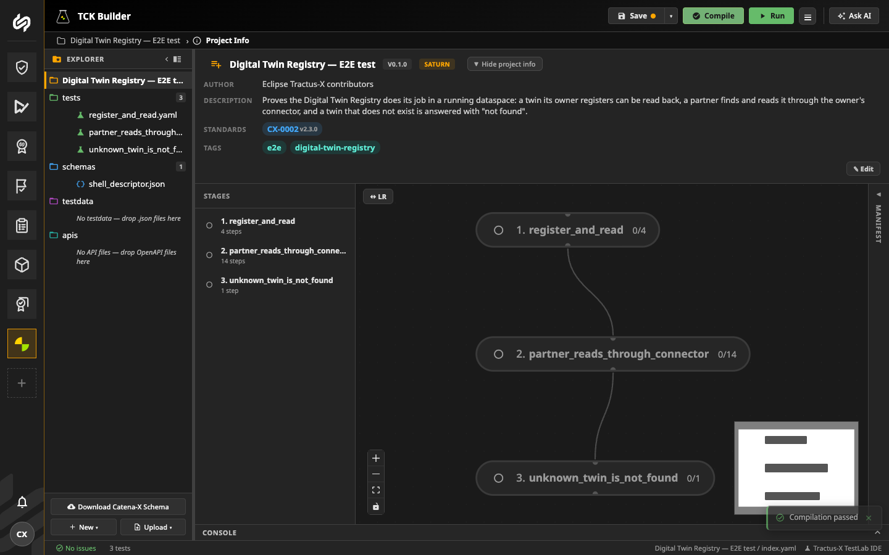

<span class="route">The tutorial · chapter 3, route C · ● ● ● ● ○ ○ ○ ○</span>

# 3C · Build with your own AI tool

> **Goal:** a test project for your product that compiles, built on your laptop with the
> AI coding assistant you already have.
> **Time:** 20 minutes. It replaces chapters 3 and 4.

Take this route when you have **no API key** for the assistant in the IDE, but you do have
an assistant of your own: Claude Code, GitHub Copilot in VS Code, Cursor, Codex or a chat
app. A subscription is enough here, because you use the vendor's own tool.

The assistant does not know the [TCK](../reference/glossary.md#tck) format. The
**agent kit** teaches it: a skill with the syntax, the patterns, the template and a review
checklist. Expect a little less comfort than in the IDE. It works.

## Steps

1. Install the [TestLab](../reference/glossary.md#testlab) command line. Your assistant
   uses it to check its own work:

    ```bash
    pip install "tractusx-testlab==1.0.0a24"
    ```

2. Clone the [fork](../reference/glossary.md#fork-and-pull-request) you made in chapter 2
   and start a branch:

    ```bash
    git clone https://github.com/<your-user>/<your-product>.git
    cd <your-product>
    git switch -c test/e2e-test
    ```

3. Get the tutorial's files next to it, and install the skill for your tool. Use
   `claude`, `copilot`, `cursor` or `codex`:

    ```bash
    git clone --depth 1 https://github.com/eclipse-tractusx/tutorial-resources.git ../tutorial-resources
    ../tutorial-resources/e2e-testing/agent-kit/install.sh claude
    ```

    Another tool, or a chat app? See [Set up your AI tool](../reference/ai-tool-setup.md).

4. Copy the template into your repository:

    ```bash
    mkdir -p tck .github/workflows
    cp -R ../tutorial-resources/e2e-testing/template/tck/e2e tck/e2e
    ```

5. Open the repository folder in your assistant, start a **new** chat and send this, with
   your product and your sentence from chapter 2:

    ```text
    Use the tractusx-e2e-test skill.

    My product is "<product name>" (<repository URL>).
    The test must prove: "<A partner can ..., and ... is refused.>"
    The project is in tck/e2e. It is the template: turn it into this test.
    Show me your plan first and wait for my yes.
    ```

6. Read the plan. The Skeptic asks: does each test prove a promise, is the negative test a
   real refusal, and is nothing from the handout written into a file? Correct it in plain
   words, then say yes.
7. Let the assistant write. It runs `testlab validate` after every file. When it says it is
   done, check for yourself:

    ```bash
    testlab validate tck/e2e/index.yaml
    testlab compile tck/e2e/index.yaml -o /tmp/e2e-test.tck
    ```

8. Open the IDE: the address and the account are in box **B** of your handout. Click the
   **TestLab IDE** icon in the bar on the left.
9. On the welcome screen, click **Open Folder** and choose the folder `tck/e2e` of your
   repository.
10. Press **Compile**.

Now continue with [chapter 5](05-run-it.md). In [chapter 6](06-add-to-repository.md),
skip steps 1, 2, 3 and 5: your files are already in your repository, with their licence
headers.

## You should now see

In the terminal:

```text
OK — index.yaml is valid (no issues)
```

In the IDE, your tests in the explorer on the left and the message **Compilation passed**.



> [!NOTE]
> You changed something in the IDE afterwards? Then the IDE has the newest version, not
> your folder. Export it as in chapter 6, step 1, and unpack it over `tck/e2e`. The export
> drops comments, so add the licence headers again as in chapter 6, step 5.

> [!TIP]
> **Stuck?**
>
> - **The assistant does not seem to know the skill:** start a new chat, or point it at
>   the file: `Read ../tutorial-resources/e2e-testing/agent-kit/AGENTS.md and follow it.`
> - **It invents steps:** say `Use only steps that testlab docs lists.`
> - **`testlab` is not found:** the `pip install` went into another Python. Try
>   `python3 -m pip install "tractusx-testlab==1.0.0a24"` and open a new terminal.
> - **`validate` stays red after three rounds:** copy the template again (step 4) and ask
>   for one test at a time.
> - **Your assistant cannot run commands:** run `testlab validate` yourself and paste the
>   output back to it.

---

[← 3 · Choose your AI](03-choose-your-ai.md) · [Home](../index.md) · [Next: 5 · Run it against your connectors →](05-run-it.md)

## NOTICE

This work is licensed under the [CC-BY-4.0](https://creativecommons.org/licenses/by/4.0/legalcode).

- SPDX-License-Identifier: CC-BY-4.0
- SPDX-FileCopyrightText: 2026 Contributors to the Eclipse Foundation
- SPDX-FileCopyrightText: 2026 Catena-X Automotive Network e.V.
- Source URL: <https://github.com/eclipse-tractusx/tutorial-resources>
