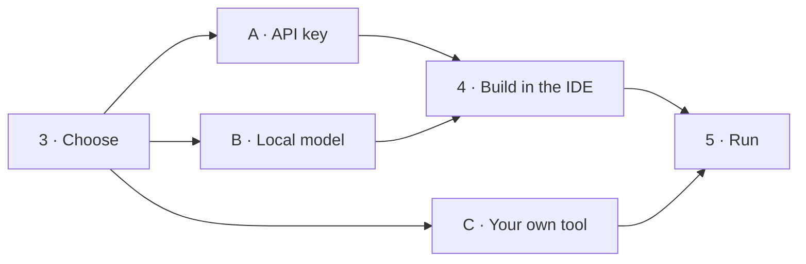

The tutorial · chapter 3 of 8 · ● ● ● ○ ○ ○ ○ ○

# 3 · Choose your AI

> **Goal:** pick the AI help that fits your laptop and what you brought.
> **Time:** 1 minute

There are three routes. They all end in the same place: a test project that compiles,
ready for chapter 5. Not sure? Take **A** if you have a key, otherwise **C** if you have
an AI coding tool, otherwise **B**.

-   **A · An API key in the IDE**

    ---

    You have a key from OpenAI, Anthropic or Catena-X AI.
    Fastest, and the best results.

    *You need:* the key. *Time:* 5 + 15 minutes.

    [Take route A →](03-open-the-ide.md)

-   **B · A local model in the IDE**

    ---

    The model runs on your own laptop. No key, and nothing leaves your machine.
    Good for small, clear changes.

    *You need:* Ollama and 8 GB of RAM or more. *Time:* 10 + 20 minutes.

    [Take route B →](03b-local-model.md)

-   **C · Your own AI tool, then upload**

    ---

    You build on your laptop with Claude Code, Copilot, Cursor or Codex, then open the
    result in the IDE. A subscription is enough.

    *You need:* your tool and Python. *Time:* 20 minutes.

    [Take route C →](03-alternative-your-own-ai-tool.md)

The details, sizes and limits of each route: [Choose your AI option](../reference/ai-options.md).

> [!TIP]
> **Stuck?**
>
> - **Nobody in the team has any of the three:** join a team that has one, or change the
>   template by hand with the [worked example](../reference/worked-example.md) next to you.

---

[← 2 · Your product and your connectors](02-your-product.md) · [Home](../index.md)

## NOTICE

This work is licensed under the [CC-BY-4.0](https://creativecommons.org/licenses/by/4.0/legalcode).

- SPDX-License-Identifier: CC-BY-4.0
- SPDX-FileCopyrightText: 2026 Contributors to the Eclipse Foundation
- SPDX-FileCopyrightText: 2026 Catena-X Automotive Network e.V.
- Source URL: <https://github.com/eclipse-tractusx/tutorial-resources>
