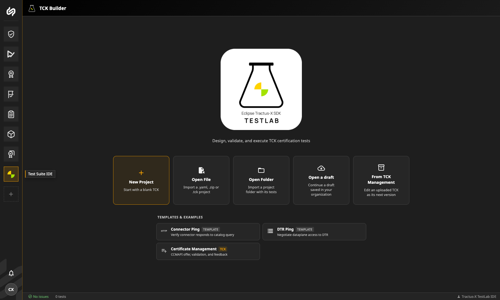

<span class="route">Getting Started · chapter 3 of 9 · ● ● ● ○ ○ ○ ○ ○ ○</span>

# 3 · Hello, TestLab: your first test, by hand

> **Goal:** write one small test yourself, see it pass, then see it fail. No AI yet.
> **Time:** 15 minutes

## The service you test

The **hello service** is a tiny API. Its address is in box **B** of your handout.

| Call | Answers |
| --- | --- |
| `GET /hello` | `{"message": "Hello, Tractus-X!"}` |
| `GET /parts` | The parts `P-1001` and `P-1002` |
| `GET /parts/{partId}` | That part, or `404` |
| `GET /health` | `{"status": "UP"}` |

??? info "Full specification (OpenAPI)"

    ```yaml
    --8<-- "hello-service/site/openapi.yaml:20:"
    ```

Not at the workshop? Run it with Docker as its
[README](https://github.com/eclipse-tractusx/tutorial-resources/tree/main/e2e-testing/hello-service)
shows, at `http://localhost:8080`.

## The test

```yaml title="tests/says_hello.yaml"
--8<-- "examples/hello/tck/hello/tests/says_hello.yaml:21:"
```

- `uses` picks the action: one HTTP request.
- `with` gives its inputs. `${{ env.service_url }}` is the address, taken from the manifest.
- `returns` names the outputs you check.
- `validate` holds the checks. The step passes only if all of them hold.

The [syntax cheat sheet](../reference/syntax.md) explains every part.

## Steps

=== "VS Code"

    1. Install TestLab (Python 3.12+) and the VS Code extension **YAML** by Red Hat:

        ```bash
        pip install "tractusx-testlab==1.0.0a24"
        ```

    2. Unpack [`hello-start.zip`](../downloads/hello-start.zip) into a folder `hello` and
       open it in VS Code.
    3. In `index.yaml`, set `service_url` to the address on your handout.
    4. Create `tests/says_hello.yaml` with the test above. Its first line turns on
       autocomplete:

        ```yaml
        # yaml-language-server: $schema=https://raw.githubusercontent.com/eclipse-tractusx/tractusx-testlab/v1-alpha24/src/tractusx_testlab/compiler/schemas/tck_test.schema.json
        ```

    5. In `index.yaml`, replace `tests: []` with:

        ```yaml
        tests:
          - id: says_hello.yaml
            name: The service says hello
        ```

    6. Run:

        ```bash
        testlab validate index.yaml
        testlab run index.yaml --yes
        ```

=== "Test Suite IDE"

    1. Open the Test Suite (box **B**) and click the **Test Suite IDE** icon on the left.
    2. Click **Open File** and choose [`hello-start.zip`](../downloads/hello-start.zip).

        

    3. **☰ → Environment → Variables → `service_url`**: enter the address on your handout.
    4. **New ▾ → New Test**, then click `new-test.yaml`.
    5. Open the **YAML Editor** at the right edge, click **Edit**, paste the test, click
       **Save**. The blocks appear.

        

    6. Click **Compile**, then **Run**. Save the draft, and click **Run** again if it does
       not start. Pick any app under test (or **Register an app**), click **Next** to the
       end, then **Run**.

    More on every button: [The Test Suite IDE](../reference/ide.md).

## You should now see

```text
  ✓ The service says hello                              PASS
RESULT: PASS  |  1 passed  0 failed  0 skipped
```


## Make it fail

1. Change the expected greeting to `Hello, world!` and run. It fails with
   `Expected 'Hello, world!', got 'Hello, Tractus-X!'`.
2. Change it back. Green again.

## Your turn

Write `tests/unknown_part_is_not_found.yaml`: ask for part `P-9999`, expect `404`.
Register it and run.

??? tip "Solution"

    ```yaml title="tests/unknown_part_is_not_found.yaml"
    --8<-- "examples/hello/tck/hello/tests/unknown_part_is_not_found.yaml:21:"
    ```

??? example "More time? Check the shape of a part"

    ```yaml title="tests/reads_a_part.yaml"
    --8<-- "examples/hello/tck/hello/tests/reads_a_part.yaml:21:"
    ```

    The finished project is in
    [`examples/hello`](https://github.com/eclipse-tractusx/tutorial-resources/tree/main/e2e-testing/examples/hello/tck/hello).

> [!TIP]
> **Stuck?** YAML error: check the indentation (two spaces, no tabs). Service unreachable:
> open `<address>/health` in the browser. No blocks in the IDE: click **Save** in the YAML
> editor.

---

[← 2 · Your product and your connectors](02-your-product.md) · [Home](../index.md) · [Next: 4 · Choose your AI →](04-choose-your-ai.md)

## NOTICE

This work is licensed under the [CC-BY-4.0](https://creativecommons.org/licenses/by/4.0/legalcode).

- SPDX-License-Identifier: CC-BY-4.0
- SPDX-FileCopyrightText: 2026 Contributors to the Eclipse Foundation
- SPDX-FileCopyrightText: 2026 Catena-X Automotive Network e.V.
- Source URL: <https://github.com/eclipse-tractusx/tutorial-resources>
