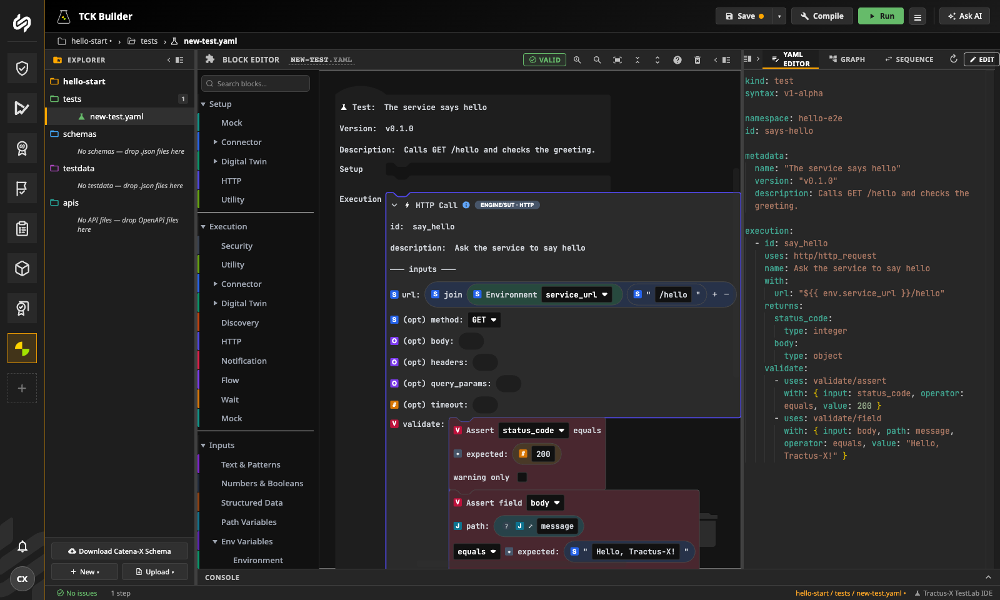
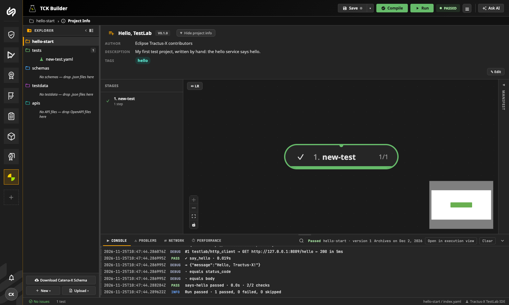

<span class="route">Getting Started · chapter 3 of 9 · ● ● ● ○ ○ ○ ○ ○ ○</span>

# 3 · Hello, TestLab: your first test, by hand

> **Goal:** you write a small test yourself, run it green, then make it red on purpose. No AI yet.
> **Time:** 15 minutes

Before an assistant writes a test for you, write one yourself. Then you can read what it
writes, and you notice when it is wrong.

## The service you test

The **hello service** is a tiny API that runs for this workshop. Its address is on your
handout, box **B**, next to **Hello service**. Open `<address>/hello` in your browser: it
answers `{"message": "Hello, Tractus-X!"}`.

| Call | Answer |
| --- | --- |
| `GET /hello` | `200` and `{"message": "Hello, Tractus-X!"}` |
| `GET /parts` | `200` and the two parts it knows, `P-1001` and `P-1002` |
| `GET /parts/{partId}` | `200` and the part, or `404` when there is no part with that id |
| `GET /health` | `200` and `{"status": "UP"}` |

??? info "The full specification (OpenAPI)"

    The service also serves it at `<address>/openapi.yaml`.

    ```yaml
    --8<-- "hello-service/site/openapi.yaml:20:"
    ```

> [!NOTE]
> Not at the workshop? Run the service on your laptop with Docker, as its
> [README](https://github.com/eclipse-tractusx/tutorial-resources/tree/main/e2e-testing/hello-service)
> shows. Its address is then `http://localhost:8080`.

## A test in five minutes

A test project is a folder. The **manifest** `index.yaml` names the project, holds its
variables and lists its tests. Each test is one file in `tests/`. This is the first test you
write:

```yaml title="tests/says_hello.yaml"
--8<-- "examples/hello/tck/hello/tests/says_hello.yaml:21:"
```

Read it from the top:

| Part | What it says |
| --- | --- |
| `kind`, `syntax` | This is a test, in the current syntax. |
| `namespace` | The `id` of the manifest. Every test of a project has the same one. |
| `id`, `metadata` | The test's own id and what a human reads in the result. |
| `execution` | The steps of the test, in order. Bigger tests also have `setup` and `teardown`. |
| `id: say_hello` | The step's name inside the test. Later steps can refer to it. |
| `uses: http/http_request` | The ready-made action the step runs: here, one HTTP request. |
| `with:` | The values the action takes. `url` is required; `method` is `GET` unless you say otherwise. |
| `${{ env.service_url }}` | A reference: the variable `service_url` from the manifest. The address is never written into a test. |
| `returns:` | The outputs of the step you want to use: the status code and the body of the answer. |
| `validate:` | The checks. A step passes only when every check holds. |

Two kinds of check are enough for today:

- `validate/assert` compares one output: `status_code` equals `200`.
- `validate/field` looks inside an output: the field `message` of `body` equals `Hello, Tractus-X!`.

The [syntax cheat sheet](../reference/syntax.md) has every part on one page.

## Steps

Pick where you write. Both give the same files, compiled and run by the same TestLab.

=== "In VS Code, with the command line"

    1. Install TestLab. You need Python 3.12 or newer:

        ```bash
        pip install "tractusx-testlab==1.0.0a24"
        ```

    2. In VS Code, install the extension **YAML** by Red Hat. It completes and checks the
       files as you type.
    3. Download [`hello-start.zip`](../downloads/hello-start.zip), unpack it into a folder
       `hello` and open that folder in VS Code. It holds one file, `index.yaml`.
    4. In `index.yaml`, set the `value` of `service_url` to the address on your handout.
       On your laptop, keep `http://localhost:8080`.
    5. Create `tests/says_hello.yaml` and type the test above. Start the file with this line,
       so VS Code knows what a test may contain:

        ```yaml
        # yaml-language-server: $schema=https://raw.githubusercontent.com/eclipse-tractusx/tractusx-testlab/v1-alpha24/src/tractusx_testlab/compiler/schemas/tck_test.schema.json
        ```

    6. Register the test. At the end of `index.yaml`, replace `tests: []` with:

        ```yaml
        tests:
          - id: says_hello.yaml
            name: The service says hello
        ```

    7. In the terminal, in the folder `hello`:

        ```bash
        testlab validate index.yaml
        testlab compile index.yaml -o hello.tck
        testlab run index.yaml --yes
        ```

        `validate` checks the files, `compile` packs them into one package, `run` calls the
        service and checks the answers.

=== "In the Test Suite IDE"

    1. Open the address in box **B** of your handout and sign in. In the bar on the left,
       click the **Test Suite IDE** icon. The page is titled **TCK Builder**.

        

    2. Download [`hello-start.zip`](../downloads/hello-start.zip). On the welcome screen,
       click **Open File** and choose it. The project **Hello, TestLab** opens, with no tests.
    3. Set the address: click **☰** at the top right, then **Environment**. Under
       **Variables**, click `service_url` and enter the address on your handout as
       **Default value**.
    4. Under the **Explorer**, click **New ▾**, then **New Test**. Click the new file
       `new-test.yaml`.
    5. At the right edge, open the **YAML Editor** (or press Ctrl+Alt+B, ⌘+⌥+B on a Mac).
       Click **Edit**, replace all the text with the test above, and click **Save** in the
       editor. The blocks appear: the same test, drawn.

        

    6. Click **Compile** at the top. A green **Compilation passed** appears.
    7. Click **Run**. Keep the draft name and click **Save draft**; if the run does not
       start, click **Run** again. In the dialog **Run to debug**, under **App under test**,
       choose any app. If the list is empty, click **Register an app** and enter
       `Hello service`, version `1.0.0`. Click **Next** until **Summary & Launch**, then
       **Run**.

    The [Test Suite IDE](../reference/ide.md) page shows every part of the screen.

## You should now see

A green run of one test, one step and two checks:

```text
  ✓ The service says hello                              PASS
RESULT: PASS  |  1 passed  0 failed  0 skipped
```



## Make it red

A check you have never seen fail proves nothing. Break the test on purpose:

1. Change the expected greeting to `Hello, world!` and run again. The run fails and says why:

    ```text
    Expected 'Hello, world!', got 'Hello, Tractus-X!'
    ```

2. Change it back. Now rename the output under `returns:` from `body` to `message`, and
   compile. This time nothing runs: the compiler knows what the step publishes.

    ```text
    'returns' name 'message' is not produced by step 'http/http_request'.
    It publishes: body, ..., status_code, value.
    ```

3. Put `body` back. Green again.

## Your turn: a negative test

A good test also checks that the wrong thing is refused. Write a second test,
`tests/unknown_part_is_not_found.yaml`: ask for the part `P-9999` and check that the answer
is `404`. Register it in `index.yaml` (VS Code) or add it with **New Test** (IDE), then run.

??? tip "Stuck? The solution"

    ```yaml title="tests/unknown_part_is_not_found.yaml"
    --8<-- "examples/hello/tck/hello/tests/unknown_part_is_not_found.yaml:21:"
    ```

??? example "More time? A contract test"

    The specification promises the shape of a part. `validate/schema` checks an answer against
    a JSON schema in the project's `schemas/` folder. The finished project, with this third
    test, is in
    [`examples/hello`](https://github.com/eclipse-tractusx/tutorial-resources/tree/main/e2e-testing/examples/hello/tck/hello).

    ```yaml title="tests/reads_a_part.yaml"
    --8<-- "examples/hello/tck/hello/tests/reads_a_part.yaml:21:"
    ```

> [!TIP]
> **Stuck?**
>
> - **"mapping values are not allowed" or a similar YAML error:** the indentation is off.
>   YAML counts spaces, two per level, and no tabs.
> - **`testlab: command not found`:** open a new terminal, or install into a virtual
>   environment and activate it first.
> - **The run cannot reach the service:** open `<address>/health` in the browser. If that
>   fails too, the address in `index.yaml` is wrong.
> - **The IDE shows "Fix issues" and no blocks after you pasted:** click **Save** in the
>   YAML editor; the blocks follow the text only when it is saved.

---

[← 2 · Your product and your connectors](02-your-product.md) · [Home](../index.md) · [Next: 4 · Choose your AI →](04-choose-your-ai.md)

## NOTICE

This work is licensed under the [CC-BY-4.0](https://creativecommons.org/licenses/by/4.0/legalcode).

- SPDX-License-Identifier: CC-BY-4.0
- SPDX-FileCopyrightText: 2026 Contributors to the Eclipse Foundation
- SPDX-FileCopyrightText: 2026 Catena-X Automotive Network e.V.
- Source URL: <https://github.com/eclipse-tractusx/tutorial-resources>
