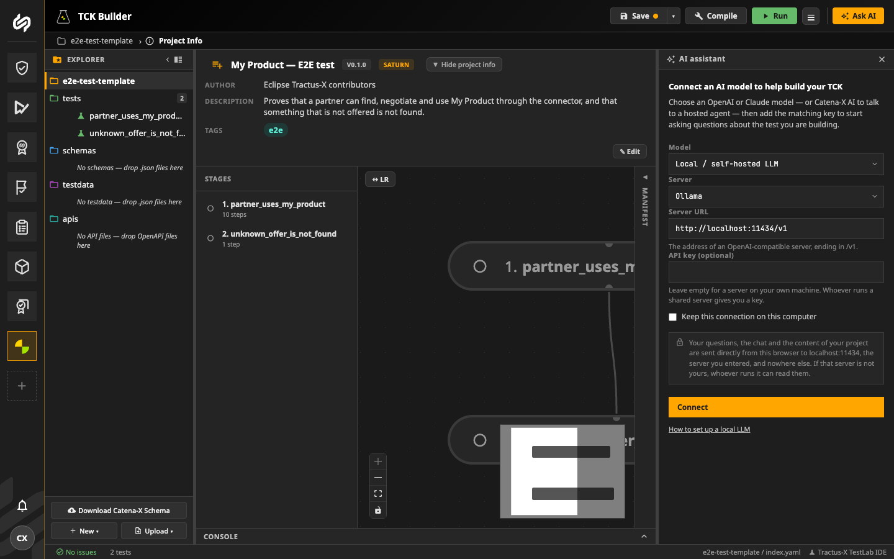

<span class="route">The tutorial · chapter 3, route B · ● ● ● ○ ○ ○ ○ ○</span>

# 3B · Connect a local model

> **Goal:** a model on your own laptop answers you in the IDE.
> **Time:** 10 minutes, plus the download

The model runs on your laptop, so nothing leaves your machine. The IDE's
**Small model mode** gives it short instructions and lets it look up what it needs, so even
a small model answers in seconds.

## Which model?

| Your laptop | Take | Download |
| --- | --- | --- |
| 8 GB of RAM | `qwen2.5:3b` | 2 GB |
| 16 GB of RAM | `qwen2.5:3b` or `qwen2.5:7b` | 2 or 5 GB |
| 32 GB or more, Apple Silicon or a large GPU | A larger model, for example `qwen2.5:14b` or `qwen3:30b` | 9 to 18 GB |

In our trial, `qwen2.5:3b` and `qwen2.5:7b` both made every change the tutorial needs.
Take the 3B unless your laptop has room to spare. The larger ones we have not tried. On a
laptop without a GPU, expect a minute per step: route A or C is the better choice there.

## Steps

1. Install [Ollama](https://ollama.com).
2. Download the model. Best at home, before the session:

    ```bash
    ollama pull qwen2.5:3b
    ```

3. Start Ollama so that the IDE may call it. Put the address from box **B** of your handout
   in place of the example:

    ```bash
    OLLAMA_ORIGINS="https://ide.example.org" OLLAMA_CONTEXT_LENGTH=8192 ollama serve
    ```

4. Open the address in box **B** and sign in. Click the **Test Suite IDE** icon on the left.
5. Download the template, [`e2e-test-template.zip`](../downloads/e2e-test-template.zip),
   and open it with **Open File** on the welcome screen.
6. At the top right, click **Ask AI**. Under **Model**, choose **Local / self-hosted LLM**.
   Keep **Server** at **Ollama** and click **Connect**.
7. Choose your model in the list. Leave **Small model mode** switched on.
8. Type `Hello. What is in this project?` and press Enter.

## You should now see



After step 8, the assistant answers with a short description of the two tests, within
half a minute.

## How to talk to a small model

You will use these in chapter 4:

- **One change per message.** "Rename the step", then "add a check". Not "write the test".
- **Name the file every time:** `In tests/partner_uses_my_product.yaml …`. Each message
  stands alone; the model does not remember the previous one.
- **Read every change.** Each one is listed above the message box with **Review** and **Undo**.

> [!NOTE]
> **Small model mode** is new. If your IDE does not show the switch yet, a local model
> needs `OLLAMA_CONTEXT_LENGTH=65536` and a fast machine, and the first answer takes
> minutes. Then take route A or C.

> [!TIP]
> **Stuck?**
>
> - **"Could not load the server's models":** Ollama is not running, or the address in
>   `OLLAMA_ORIGINS` is not exactly the IDE's address. Stop it and start it again (step 3).
> - **It answers but never changes a file:** you are in **Ask** or **Plan**. Switch to
>   **Agent**.
> - **It keeps getting it wrong:** ask for a smaller change, or switch to route
>   [A](03-open-the-ide.md) or [C](03-alternative-your-own-ai-tool.md).

---

[← 3 · Choose your AI](03-choose-your-ai.md) · [Home](../index.md) · [Next: 4 · Build the test with the assistant →](04-build-the-test.md)

## NOTICE

This work is licensed under the [CC-BY-4.0](https://creativecommons.org/licenses/by/4.0/legalcode).

- SPDX-License-Identifier: CC-BY-4.0
- SPDX-FileCopyrightText: 2026 Contributors to the Eclipse Foundation
- SPDX-FileCopyrightText: 2026 Catena-X Automotive Network e.V.
- Source URL: <https://github.com/eclipse-tractusx/tutorial-resources>
