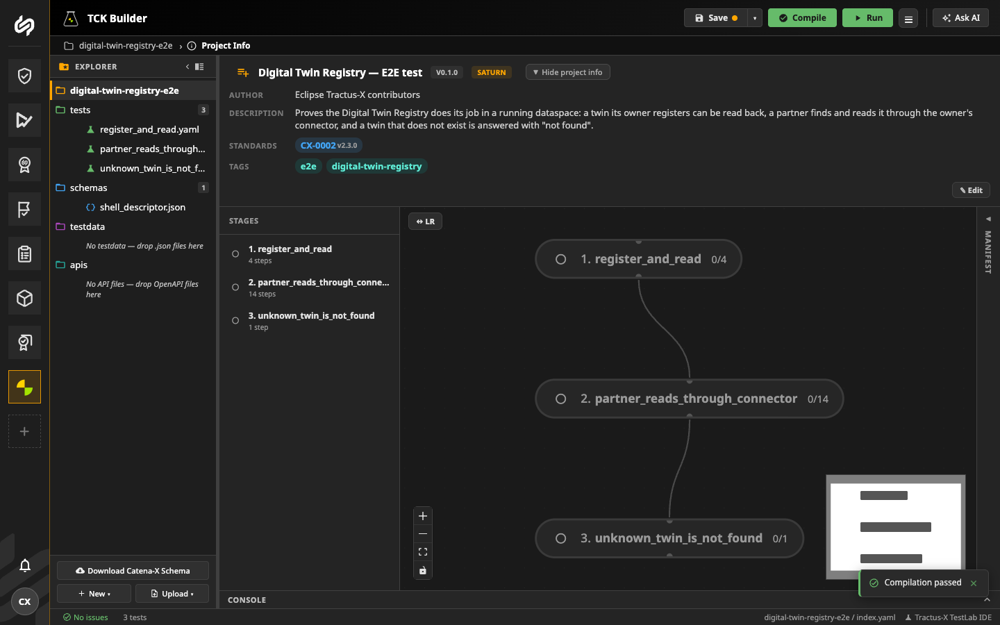

<span class="route">The tutorial · chapter 4 of 8 · ● ● ● ● ○ ○ ○ ○</span>

# 4 · Build the test with the assistant

> **Goal:** a test project for your product that compiles.
> **Time:** 15 minutes

You say **what** must be proven. The assistant writes **how**. The Skeptic reads every line.

## Steps

1. Press **Compile** at the top. The template compiles as it is: you start from green.
2. In the assistant panel, switch the mode to **Plan**. A plan changes nothing.
3. Paste [starter prompt 1](../reference/prompts.md#1-plan-the-test) and fill in your
   product, its repository and your sentence from chapter 2. Send it.
4. Read the plan. The Skeptic asks three questions:

    | Question | A good plan says |
    | --- | --- |
    | Does each test prove a **promise**? | What the partner gets, not just "status 200" |
    | Is the negative test really a **refusal**? | The exact answer the product must give |
    | Are addresses and [BPNs](../reference/glossary.md#bpn) **variables**? | Nothing from your handout appears in a test |

5. Correct the plan in plain words until you agree with it.
6. Press **Carry out this plan**. The assistant switches to **Agent** and writes the files.
7. In the bar **Changes by the AI assistant**, press **Review** and read what changed.
   **Undo file** and **Undo all** put things back.
8. Press **Compile**.
9. Not green? Send this, and repeat until it is:

    ```text
    Compile the project and fix what the compiler reports. Change nothing else.
    ```

10. Press **Save**, give the draft your product's name, and press **Save draft**.

## You should now see

The message **Compilation passed**, and your tests in the explorer on the left.



<details>
<summary>What the pilot team built</summary>

Three tests for the Digital Twin Registry:

| Test | Kind |
| --- | --- |
| A registered twin can be read back and matches the AAS schema | Positive, contract |
| A partner finds and reads the twin through the owner's connector | Positive, the journey |
| A twin that does not exist is answered with 404 | Negative |

Read them in the [worked example](../reference/worked-example.md).

</details>

> [!NOTE]
> **On route B, with a local model:** send one change per message and name the file in
> each one, for example `In tests/partner_uses_my_product.yaml rename the step
> call_product to "Partner calls my product"`. A whole test in one message is too much for a
> small model.

> [!TIP]
> **Stuck?**
>
> - **The assistant invents steps:** say `Use only steps from the block catalog.`
> - **Compile stays red after three rounds:** switch to **Ask**, paste the finding and ask
>   what the compiler expects there, before you let it edit again.
> - **Minute 30 and still red, or no model at all:** press **Undo all** and change only the
>   names by hand. Click a file, open the **YAML Editor** tab, press **Edit**, replace
>   `my-product` with your product's id and `My Product` with its name, and press **Save**.
>   Do it in `index.yaml` and in both tests. A small green test beats a large red one.
> - **More prompts:** [Starter prompts](../reference/prompts.md).

---

[← 3 · Choose your AI](03-choose-your-ai.md) · [Home](../index.md) · [Next: 5 · Run it against your connectors →](05-run-it.md)

## NOTICE

This work is licensed under the [CC-BY-4.0](https://creativecommons.org/licenses/by/4.0/legalcode).

- SPDX-License-Identifier: CC-BY-4.0
- SPDX-FileCopyrightText: 2026 Contributors to the Eclipse Foundation
- SPDX-FileCopyrightText: 2026 Catena-X Automotive Network e.V.
- Source URL: <https://github.com/eclipse-tractusx/tutorial-resources>
