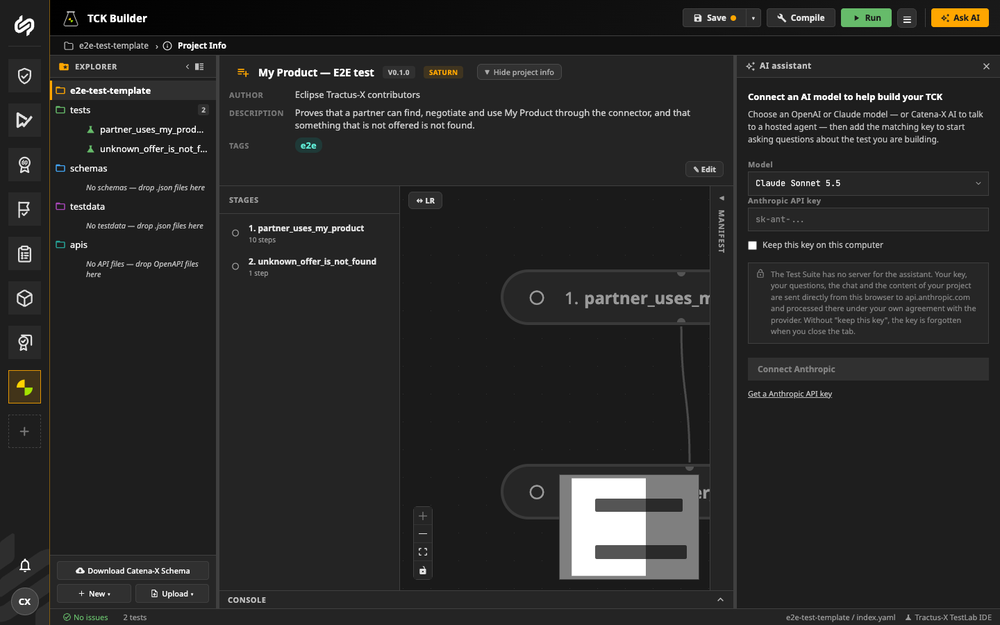

Getting Started · chapter 4, route A · ● ● ● ● ○ ○ ○ ○ ○

# 4A · Connect your API key in the IDE

> **Goal:** the assistant in the IDE answers you.
> **Time:** 5 minutes

You know the IDE from [chapter 3](03-hello-testlab.md). Now you open your team's project
in it and connect the assistant.

## Steps

1. Download the template: [`e2e-test-template.zip`](../downloads/e2e-test-template.zip).
2. In the IDE, click **☰** at the top right, then **File**, then **File or package**, and
   choose the ZIP you just downloaded. (Closed the IDE? Open the address in box **B**, click
   the **Test Suite IDE** icon on the left, then **Open File** on the welcome screen.)
3. At the top right, click **Ask AI**.
4. Under **Model**, choose the model you brought:

    | You brought | Choose | Then enter |
    | --- | --- | --- |
    | An OpenAI key | A **GPT** model | Your key, then **Connect OpenAI** |
    | An Anthropic key | A **Claude** model | Your key, then **Connect Anthropic** |
    | Catena-X AI access | **Catena-X AI** | Your key and agent ID |

5. Type `Hello. What is in this project?` and press Enter.

## You should now see

The template project on the left, with its two tests, and the assistant panel on the right.

After step 5, the assistant answers with a short description of the two tests.

> [!NOTE]
> Your key goes from your browser straight to the provider you chose. The Test Suite has no
> server for the assistant. Without **Keep this key on this computer**, the key is forgotten
> when you close the tab.

> [!TIP]
> **Stuck?**
>
> - **A "Welcome" dialog covers the page:** close it with the **×** at its top right.
> - **The key is refused:** copy it again without spaces. A ChatGPT or Claude subscription
>   is not an API key.
> - **No API key, but a subscription to an AI coding assistant:** take
>   [route C](04c-your-own-ai-tool.md). You build on your laptop with
>   your own tool and open the result here.
> - **Nobody in the team has a model:** join a team that has one, or build by hand from the
>   [worked example](../reference/worked-example.md).

---

[← 4 · Choose your AI](04-choose-your-ai.md) · [Home](../index.md) · [Next: 5 · Build the test with the assistant →](05-build-the-test.md)

## NOTICE

This work is licensed under the [CC-BY-4.0](https://creativecommons.org/licenses/by/4.0/legalcode).

- SPDX-License-Identifier: CC-BY-4.0
- SPDX-FileCopyrightText: 2026 Contributors to the Eclipse Foundation
- SPDX-FileCopyrightText: 2026 Catena-X Automotive Network e.V.
- Source URL: <https://github.com/eclipse-tractusx/tutorial-resources>
