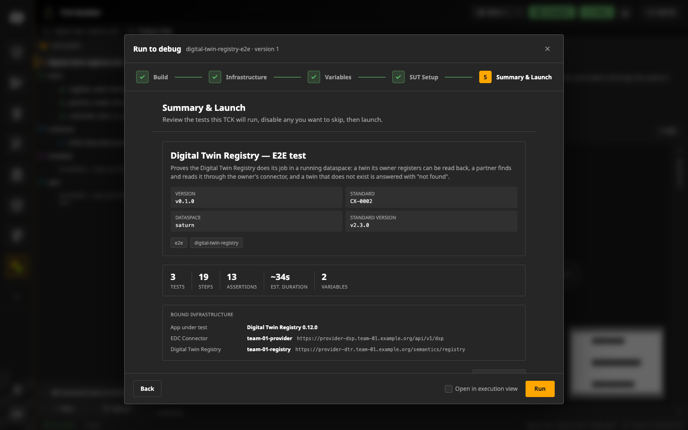
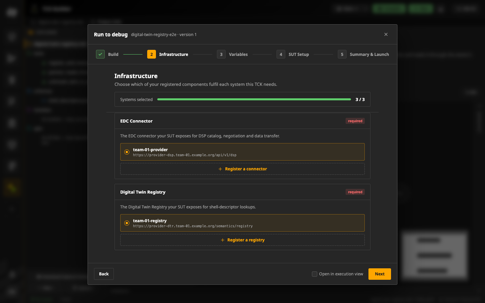

The tutorial · chapter 5 of 8 · ● ● ● ● ● ○ ○ ○

# 5 · Run it against your connectors

> **Goal:** a green run, and one red run that you caused on purpose.
> **Time:** 10 minutes

## Steps

1. Press **Run** at the top. The dialog **Run to debug** opens with five steps.

    | Step | You do |
    | --- | --- |
    | **Build** | Nothing. It ends with "Compiled — ready to run." Press **Next**. |
    | **Infrastructure** | Choose your product under **App under test** and your connector under **EDC Connector**. If your test uses a registry, choose it under **Digital Twin Registry**. Press **Next**. |
    | **Variables** | Click each value in the list. Fill in what is empty from box **C** of your handout: `product_internal_url` is "Product, as the connector reaches it", `dtr_internal_url` is "Registry, as the connector reaches it". Where the dialog offers a list, choose from it. Press **Next**. |
    | **SUT Setup** | Press **Start review**, then **Accept all** and **Confirm all**. Your test creates these offers itself, in its setup. Press **Next**. |
    | **Summary & Launch** | Check the list of tests. Press **Run** at the bottom right. |

    You type nothing from box **D**. The partner side is set up by the administrators.

2. Watch the **Console** at the bottom. Each step turns green or red as it finishes.
3. Wait for the result.
4. Now break it on purpose. Open your negative test, change the expected value of one
   check, for example `0` to `1` or `404` to `200`, and run again.
5. See it turn red **at that check**. Change it back and run once more.

A test that has never failed has proven nothing yet. Step 4 is the difference between a test
and a script that prints green.

## You should now see

The last step of the dialog, with your tests and your connector listed, and after the run
the status **Passed**.

The second step, **Infrastructure**, looks like this when your components are registered:

> [!NOTE]
> Nothing to choose under **Infrastructure**? Register it yourself, with the values of box
> **C**: **Register an app** (name and version of your product), **Register a connector**
> (name, DSP URL, Participant ID and DID) and **Register a registry** (name and base URL).

> [!TIP]
> **Stuck?**
>
> - **The run fails at once with "requires infrastructure that is not fully bound:
>   engine.connector":** the partner side is not set up for your team. Go to the Desk.
> - **The run waits:** give it a minute, then ask at the Desk whether your connectors are up.
> - **A value is refused as "not a public host name":** use the address from box **C**
>   exactly as printed.
> - **A step is red:** open it and read the request and the answer. Decide which it is:
>     - **The environment.** Nothing answered, or a value is wrong. Fix the value or ask.
>     - **A finding.** The product answered, and not as your check expects. Either your
>       reading of the promise is wrong, or the product is. Both are worth knowing.
> - **Minute 40 and no green run:** go on to chapter 6. The workflow runs your test again
>   in CI, in a dataspace of its own.

---

[← 4 · Build the test with the assistant](04-build-the-test.md) · [Home](../index.md) · [Next: 6 · Add it to your repository →](06-add-to-repository.md)

## NOTICE

This work is licensed under the [CC-BY-4.0](https://creativecommons.org/licenses/by/4.0/legalcode).

- SPDX-License-Identifier: CC-BY-4.0
- SPDX-FileCopyrightText: 2026 Contributors to the Eclipse Foundation
- SPDX-FileCopyrightText: 2026 Catena-X Automotive Network e.V.
- Source URL: <https://github.com/eclipse-tractusx/tutorial-resources>
