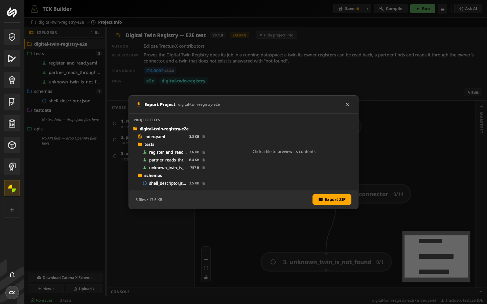

<span class="route">The tutorial · chapter 6 of 8 · ● ● ● ● ● ● ○ ○</span>

# 6 · Add it to your repository

> **Goal:** your test and the workflow that runs it are committed on a branch of your fork.
> **Time:** 10 minutes

## Steps

1. In the IDE, click the **☰** menu at the top right, then **File**, then **Export**.
   In the dialog, press **Export ZIP**. The file lands in your downloads folder, named
   after your project.
2. Open a terminal and clone the [fork](../reference/glossary.md#fork-and-pull-request)
   you made in chapter 2:

    ```bash
    git clone https://github.com/<your-user>/<your-product>.git
    cd <your-product>
    git switch -c test/e2e-test
    ```

3. Unpack the ZIP into the folder `tck/e2e`:

    ```bash
    mkdir -p tck/e2e .github/workflows
    unzip ~/Downloads/<your-project>.zip -d tck/e2e
    ```

4. Add the workflow. It is the same for every product:

    ```bash
    BASE=https://raw.githubusercontent.com/eclipse-tractusx/tutorial-resources/main/e2e-testing
    curl -fsSL "$BASE/examples/digital-twin-registry/.github/workflows/e2e-test.yml" -o .github/workflows/e2e-test.yml
    ```

5. In the **same terminal**, add the licence header to your test files. Eclipse projects
   need it on every file, and the IDE's export does not write it:

    ```bash
    curl -fsSL "$BASE/template/license-header.txt" -o /tmp/license-header.txt
    for f in $(find tck/e2e -name '*.yaml'); do
      cat /tmp/license-header.txt "$f" > "$f.new" && mv "$f.new" "$f"
    done
    ```

6. Commit, with a sign-off:

    ```bash
    git add tck .github/workflows/e2e-test.yml
    git commit -s -m "test: add an E2E test"
    ```

## You should now see

```bash
git show --stat HEAD
```

```text
    test: add an E2E test

    Signed-off-by: Your Name <you@example.org>

 .github/workflows/e2e-test.yml               |  44 ++++
 tck/e2e/index.yaml                           | ...
 tck/e2e/tests/<your-first-test>.yaml         | ...
 tck/e2e/tests/<your-second-test>.yaml        | ...
```

And this is all the workflow is: a few lines that call a
[reusable workflow](../reference/glossary.md#reusable-workflow).



> [!TIP]
> **Stuck?**
>
> - **`curl` answers 404:** the tutorial is not published at that address yet. Ask a
>   facilitator for the address to use, also for the `uses:` line of the workflow file.
> - **No `unzip` on your machine:** unpack the ZIP with your file manager and move
>   `index.yaml` and `tests` into `tck/e2e`.
> - **Your repository already has a folder `tck/e2e`:** choose another folder, and change
>   `tck-directory` in the workflow file to match.
> - **Your product does not run in the developer toolbox:** open
>   `.github/workflows/e2e-test.yml` and add `run-in-toolbox: false` under `tck-directory`. The workflow then validates and
>   compiles only. See [The workflow](../reference/workflow.md).
> - **`Signed-off-by` is missing:** you forgot `-s`. Run `git commit --amend -s --no-edit`.

---

[← 5 · Run it against your connectors](05-run-it.md) · [Home](../index.md) · [Next: 7 · Link it and open the pull request →](07-link-and-pull-request.md)

## NOTICE

This work is licensed under the [CC-BY-4.0](https://creativecommons.org/licenses/by/4.0/legalcode).

- SPDX-License-Identifier: CC-BY-4.0
- SPDX-FileCopyrightText: 2026 Contributors to the Eclipse Foundation
- SPDX-FileCopyrightText: 2026 Catena-X Automotive Network e.V.
- Source URL: <https://github.com/eclipse-tractusx/tutorial-resources>
