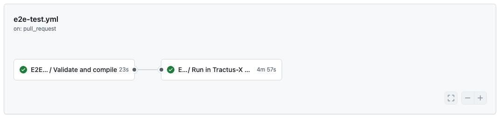

<span class="route">The tutorial · chapter 7 of 8 · ● ● ● ● ● ● ● ○</span>

# 7 · Link it and open the pull request

> **Goal:** a draft pull request in your product's repository, with the test linked in `.tractusx`.
> **Time:** 5 minutes

## Steps

1. Open the file `.tractusx` in the root of your repository. It is the
   [metafile](../reference/glossary.md#tractusx-metafile) that describes the product.
2. Add this block at the end, with your product's name:

    ```yaml
    e2eTests:
      - name: "<Your product> E2E test"
        path: "tck/e2e"
        workflow: ".github/workflows/e2e-test.yml"
    ```

3. Commit and push:

    ```bash
    git add .tractusx
    git commit -s -m "chore: link the E2E test in the metafile"
    git push -u origin test/e2e-test
    ```

4. Open your fork on GitHub. Press **Compare & pull request** in the yellow banner.
5. Check that the base repository is `eclipse-tractusx/<your-product>`. Write one sentence
   per test: what it proves.
6. Open the arrow next to the green button, choose **Create draft pull request** and press it.
7. Ring the bell.

## You should now see

Your pull request, with the checks starting at the bottom: **Validate and compile** finishes
in under a minute, **Run in Eclipse Tractus-X developer toolbox** in about five.



Click the second job and scroll to **E2E test result**. This is the pilot team's:

```text
TCK RUN SUMMARY
  ✓ Register and read                          PASS
  ✓ A partner reads through the connector      PASS
  ✓ An unknown twin is not found               PASS
RESULT: PASS  |  3 passed  0 failed  0 skipped
```

> [!NOTE]
> The first contribution of a person to a repository needs a committer's approval before
> its workflows run. If your checks say **waiting for approval**, that is the reason, not an
> error. A facilitator knows who can approve.

> [!TIP]
> **Stuck?**
>
> - **You want to see it run now:** open a second pull request **inside your fork**, from
>   `test/e2e-test` to your fork's `main`. It needs no approval and runs at once.
> - **The ECA check is red:** the email of your commits is not the one of your Eclipse
>   account. See [Troubleshooting](../reference/troubleshooting.md#git-and-github).
> - **`git push` is refused:** GitHub wants a token or an SSH key, not your password.
>   Let a teammate whose laptop can push be the Driver.
> - **A check fails:** [Troubleshooting](../reference/troubleshooting.md#the-workflow-is-red).

---

[← 6 · Add it to your repository](06-add-to-repository.md) · [Home](../index.md) · [Next: 8 · What comes next →](08-what-comes-next.md)

## NOTICE

This work is licensed under the [CC-BY-4.0](https://creativecommons.org/licenses/by/4.0/legalcode).

- SPDX-License-Identifier: CC-BY-4.0
- SPDX-FileCopyrightText: 2026 Contributors to the Eclipse Foundation
- SPDX-FileCopyrightText: 2026 Catena-X Automotive Network e.V.
- Source URL: <https://github.com/eclipse-tractusx/tutorial-resources>
