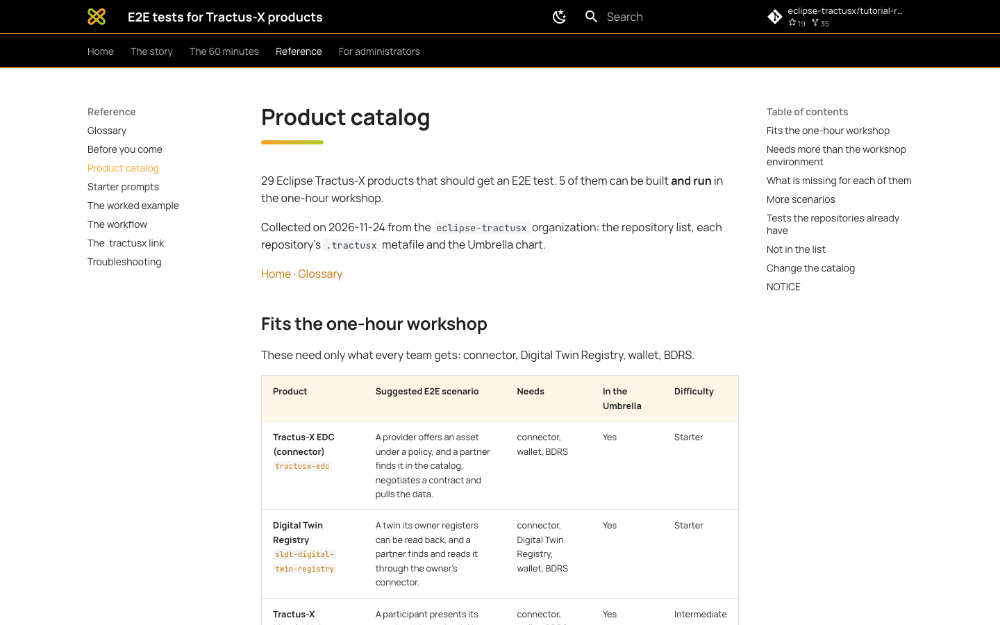

The tutorial · chapter 8 of 8 · ● ● ● ● ● ● ● ●

# 8 · What comes next

> **Goal:** you know what you built, and what your second test will be.
> **Time:** 5 minutes

## What you built today

| You have | It means |
| --- | --- |
| A [TCK project](../reference/glossary.md#tck-project) in `tck/e2e` | Your product's promise is written down in a form a machine can run |
| A workflow | It is checked on every pull request, in a fresh dataspace |
| A link in `.tractusx` | People and tools can find it |
| A draft pull request | The product's committers can take it from here |

One product has a green check that it did not have this morning.

## Steps

1. Tell the room, in one sentence each:
    - which promise your test proves,
    - what the assistant got wrong, and how you noticed.
2. Write your next scenario on the handout. The [product catalog](../reference/catalog.md)
   has more for many products, under **More scenarios**.
3. Decide who in your team takes the pull request out of draft.

## After today

| When | Do |
| --- | --- |
| This week | Answer the review comments. Mark the pull request **Ready for review**. |
| Next | Add the second scenario. It is a copy of a test file and twenty minutes. |
| Then | Test the image built from the pull request, not the released one. See [The workflow](../reference/workflow.md#test-the-image-from-your-pull-request). |
| For every product | Read the draft [TRG](../reference/glossary.md#trg) for E2E tests and say what you think. Your experience today is exactly the input it needs. |

## Where to go deeper

| Topic | Link |
| --- | --- |
| The format, every key | [TCK syntax reference](https://eclipse-tractusx.github.io/tractusx-testlab/tck-syntax/) |
| The engine | [`tractusx-testlab`](https://github.com/eclipse-tractusx/tractusx-testlab) |
| A large real project | [TestLab's own E2E test](https://github.com/eclipse-tractusx/tractusx-testlab/tree/main/tests/e2e/connector-dtr-smoke) |
| The chart behind the developer toolbox | [Tractus-X Umbrella](https://github.com/eclipse-tractusx/tractus-x-umbrella) |

## You should now see

Your pull request on the wall, next to the others.

Twenty-nine products are in the catalog. Count how many have a pull request tonight.

> [!TIP]
> **Stuck?** Nothing to be stuck on here. If your pull request is not open yet, go back to
> [chapter 7](07-link-and-pull-request.md): a draft with a red check still counts, and a
> facilitator will help you turn it green.

---

[← 7 · Link it and open the pull request](07-link-and-pull-request.md) · [Home](../index.md)

## NOTICE

This work is licensed under the [CC-BY-4.0](https://creativecommons.org/licenses/by/4.0/legalcode).

- SPDX-License-Identifier: CC-BY-4.0
- SPDX-FileCopyrightText: 2026 Contributors to the Eclipse Foundation
- SPDX-FileCopyrightText: 2026 Catena-X Automotive Network e.V.
- Source URL: <https://github.com/eclipse-tractusx/tutorial-resources>
